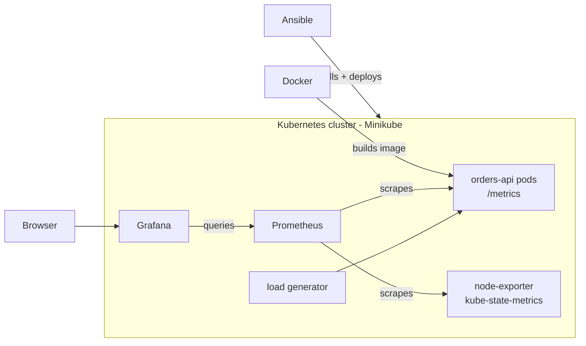

# Overview

## What we're building

A small order API (`orders-api`) runs as several copies on a Kubernetes cluster on a laptop.

- **Prometheus** collects numbers from it every 15 seconds: requests, errors, response times. It also collects numbers about the cluster: CPU, memory, restarts, replicas.
- **Grafana** shows those numbers on live dashboards.
- **Ansible** installs the tools and deploys everything with one command.

In the demo, we break things and scale things, and the dashboards react.

## How it fits together



1. Docker builds the app into an image.
2. Kubernetes runs 2 copies (pods) of it and restarts or replaces them if they fail.
3. A load generator sends steady traffic to the app.
4. Prometheus asks Kubernetes where the pods are and collects their `/metrics` every 15 s. New pods are found automatically.
5. Grafana reads from Prometheus and draws the dashboards.
6. Ansible does all of the setup, so it's repeatable on any laptop.

## Two kinds of metrics

| | Application metrics | Infrastructure metrics |
|---|---|---|
| Describe | What the app is doing for users | What the machine and cluster are doing |
| Come from | Our code (`prometheus_client`) | node-exporter, kube-state-metrics, cAdvisor |
| Examples | requests/sec, error rate, response time, orders created | CPU, memory, pod restarts, available replicas |

You need both. A healthy cluster can run a broken app, and a good app can be killed by a full node.

## What each tool does

| Tool | Job |
|---|---|
| Docker | Packages the app into an image |
| Kubernetes (Minikube) | Runs the pods, keeps 2 running, balances traffic, limits resources |
| Ansible | Installs Docker/kubectl/Minikube, deploys the app and monitoring, checks it all works |
| Prometheus | Finds the pods, collects and stores metrics, fires alerts |
| Grafana | Dashboards |

## Must have vs nice to have

**Must have:** the app with metrics · Dockerfile · Deployment with 2 replicas, health checks and limits · quota · load generator · Prometheus with auto-discovery · 4 alert rules · Grafana with 3 dashboards · Ansible install/deploy/verify/teardown · failure and scaling demos.

**Only if there's time:** autoscaling (HPA), alert emails (Alertmanager), saved metric history (persistent volume), Ingress.

**Not using:** Helm, Jenkins, Terraform, CI/CD, cloud services. They aren't needed for this project.

## Laptop requirements

Ubuntu 22.04/24.04 · 4+ CPU cores · 8 GB RAM minimum (16 GB better) · 25 GB free disk. Run `./scripts/check-env.sh` to check.

## Folder layout

```text
app/                  the Flask app, tests, Dockerfile        (Divyanth)
k8s/app/              app Kubernetes files                     (Divyanth)
k8s/monitoring/       Prometheus, Grafana, exporters           (Bhavana, Devika)
grafana/dashboards/   dashboard files, one each                (all)
ansible/              playbooks and roles                      (Devika + one role each)
scripts/              helper scripts
docs/                 these docs, screenshots, report
```

## Ports

App `30080` · Prometheus `30090` · Grafana `30030`. Open them at `http://<minikube ip>:<port>`. Every other name, port and metric is listed in [CONTRACT.md](CONTRACT.md).
