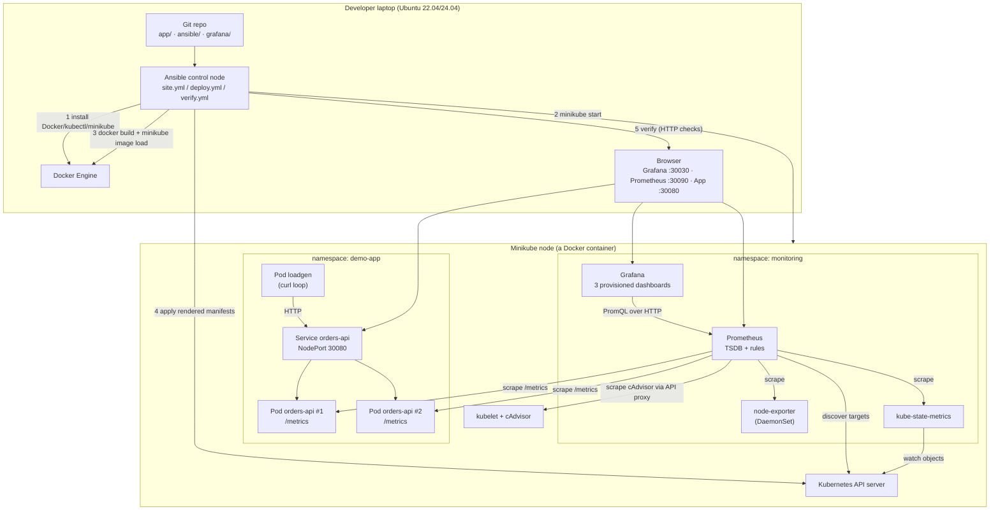

# DevOps Monitoring Platform: Project 31 Implementation Blueprint

> **This is the detailed reference.** For your day-to-day checklist, use [PLAN.md](../../PLAN.md).
>
> **Team:** M1 = **Divyanth** (Application & Workload) · M2 = **Devika** (Automation & Platform) · M3 = **Bhavana** (Observability)
>
> **Changes since v1:** T11.4 (README) moved from M2 to M1 to balance hours (all three ≈ 64 h). Version pins updated to the releases in [docs/CONTRACT.md](../CONTRACT.md).

> Status: **plan only**. Nothing described here has been built yet. Every "expected output" is what you should see once the task is done correctly.

**Working names used throughout this plan** (agree on them in T1.2 and then don't change them):

| Item | Value |
|---|---|
| Sample application | `orders-api` (Python 3.12 + Flask, port `8000`) |
| Application namespace | `demo-app` |
| Monitoring namespace | `monitoring` |
| App NodePort / Prometheus NodePort / Grafana NodePort | `30080` / `30090` / `30030` |
| Image tag | `orders-api:1.0.0` (never `latest`) |
| Team | **M1 Divyanth** (Application & Workload), **M2 Devika** (Automation & Platform), **M3 Bhavana** (Observability) |

---

## 1. Project Overview and Scope

### 1.1 The project in plain terms

You will build a small online-order API, package it into a Docker image, and run several copies of it on a Kubernetes cluster on your laptop. Next to it you will run a monitoring stack. **Prometheus** finds every running copy of the app on its own and collects numbers from it every 15 seconds: how many requests, how many failed, how slow they were. It also collects numbers about the cluster itself, such as CPU, memory, pod restarts and replica counts. **Grafana** turns those numbers into live dashboards. **Ansible** installs the tools, creates the cluster, deploys the app and the monitoring stack, and checks that everything works, all from one command. Run it again and it reproduces the same result.

When you kill a pod, Kubernetes replaces it and the dashboards show the dip and the recovery. When you scale from 2 to 5 replicas, Prometheus discovers the 3 new pods without any configuration change and the dashboards show traffic spreading across them.

### 1.2 The problem this project solves

Containers on Kubernetes are short-lived. Pods get rescheduled, restarted and scaled, and their IP addresses change. That creates three practical problems:

1. **Visibility.** Without monitoring, the only sign of a failing service is users complaining. You cannot see error rates, latency or resource pressure.
2. **Dynamic targets.** A hand-written list of servers to monitor goes stale the moment a pod restarts or scales. Monitoring has to discover targets on its own.
3. **Reproducibility.** Setting up Docker, a cluster, an application and a monitoring stack by hand is error-prone and hard to repeat on a teammate's laptop or in front of an examiner.

The platform solves (1) with Prometheus and Grafana, (2) with Prometheus's Kubernetes service discovery, and (3) with Ansible.

### 1.3 What the finished system must do

1. Run `orders-api` as **2+ replicas** on a local Kubernetes cluster, reachable through a Kubernetes Service.
2. Expose **application metrics** (`/metrics`) that Prometheus scrapes automatically, using pod annotations and service discovery.
3. Collect **infrastructure metrics**: node (node-exporter), container (cAdvisor via kubelet) and Kubernetes object state (kube-state-metrics).
4. Show **three provisioned Grafana dashboards** (Application, Kubernetes Workloads, Node & Platform) that load automatically with no clicking.
5. Recover automatically from a pod failure and make that recovery **visible** on the dashboards.
6. Scale up and down, with Prometheus **discovering new pods automatically**.
7. Be **fully reproducible**: `ansible-playbook site.yml` takes a fresh Ubuntu laptop to the working system, and a second run reports no changes (idempotency).

### 1.4 Application metrics vs infrastructure metrics

This distinction comes up in the viva, so every team member must be able to explain it.

| | Application metrics | Infrastructure metrics |
|---|---|---|
| **What they describe** | What the *software* is doing for its users | What the *platform* the software runs on is doing |
| **Who produces them** | Your code, using the `prometheus_client` library | Exporters: node-exporter, cAdvisor (inside the kubelet), kube-state-metrics |
| **Examples in this project** | `http_requests_total`, `http_request_duration_seconds`, `orders_created_total`, `http_requests_in_progress` | `node_cpu_seconds_total`, `node_memory_MemAvailable_bytes`, `container_memory_working_set_bytes`, `kube_pod_container_status_restarts_total`, `kube_deployment_status_replicas_available` |
| **Questions they answer** | Are users getting errors? Is it slow? How many orders per minute? | Is the node out of memory? Did a pod restart? Are all replicas available? |
| **Typical method** | RED: **R**ate, **E**rrors, **D**uration | USE: **U**tilisation, **S**aturation, **E**rrors, plus object state |

You need both. A healthy node can run a broken app, and a perfect app can be killed by a node running out of memory.

### 1.5 Role of each technology

| Technology | Its job in *this* project | Why it is needed | What it does **not** do here |
|---|---|---|---|
| **Docker** | Builds the `orders-api` image from a Dockerfile. It is also the Minikube driver, so the cluster node itself runs as a Docker container. | Gives an immutable, versioned artefact that runs the same on every laptop and in Kubernetes. | It does not run the production workload directly. Kubernetes does that. |
| **Kubernetes (Minikube)** | Runs the app pods and monitoring pods. Keeps the replica count, restarts failed containers, load-balances through Services and enforces resource limits. | Self-healing, scaling and service discovery are what make monitoring interesting and necessary. | |
| **Ansible** | (a) Provisions each laptop: Docker, kubectl, Minikube. (b) Creates and configures the cluster. (c) Builds the image, renders and applies manifests with project variables (replicas, image tag, scrape interval, Grafana password from Vault). (d) Runs post-deployment checks. (e) Tears everything down. | Turns a 40-step manual setup into one repeatable, idempotent command. Configuration values live in one file (`group_vars`). | It does not replace Kubernetes. Ansible *declares and applies*, and Kubernetes *keeps it running*. |
| **Prometheus** | Discovers pods and nodes through the Kubernetes API, scrapes `/metrics` endpoints, stores time series and evaluates alert rules. | Pull-based collection with service discovery fits dynamic pods. | No long-term storage and no Alertmanager notifications (optional extra). |
| **Grafana** | Reads from Prometheus through a provisioned data source and shows three provisioned dashboards. | Humans need graphs, not raw time series. | It stores no metrics of its own. |

### 1.6 Deliverables

1. A Git repository containing app source, unit tests, Dockerfile, Kubernetes manifests, Prometheus config and rules, Grafana dashboards (JSON), the Ansible project (inventory, `group_vars`, 7 roles, 4 playbooks) and helper scripts.
2. A running system that can be demonstrated live on at least one team laptop and rebuilt from scratch on another.
3. A test report with 16 test cases, each with evidence.
4. A project report (structure in Section 10), architecture diagrams, and slides.
5. A 15–20 minute demo with a written runbook (Section 9).

### 1.7 Mandatory vs optional

| Mandatory (must work for the demo) | Optional (only once all mandatory items pass) |
|---|---|
| Flask app with `/metrics`, `/health`, `/ready`, failure-injection endpoints | Horizontal Pod Autoscaler driven by CPU (metrics-server) |
| Dockerfile, non-root user, pinned versions | Alertmanager with email/Slack notifications |
| Minikube cluster; Deployment (2 replicas), Service, ConfigMap, probes, requests/limits | Persistent volume for Prometheus data |
| ResourceQuota + LimitRange on `demo-app` | Ingress with hostnames instead of NodePorts |
| Load generator running inside the cluster | Second Ansible target: a Vagrant/Multipass VM to show remote provisioning |
| Prometheus with Kubernetes SD (pods, endpoints, nodes), node-exporter, kube-state-metrics, cAdvisor | A second microservice and a service-to-service latency panel |
| 3 alert rules visible on the Prometheus *Alerts* page | Grafana alerting |
| Grafana with provisioned data source and 3 provisioned dashboards | |
| Ansible: `install.yml`, `deploy.yml`, `verify.yml`, `teardown.yml`, `site.yml`; Vault-encrypted secret; idempotent second run | |
| Failure + recovery demo; scale up/down demo | |

### 1.8 Scope decisions (to keep this achievable for three students)

- **One local cluster (Minikube, single node).** Multi-node adds no monitoring insight that justifies the extra RAM.
- **Plain YAML manifests, no Helm.** You write and understand every line. Helm charts such as kube-prometheus-stack would hide exactly the parts the examiners want to see you build.
- **No CI/CD, Jenkins, Terraform, ELK or service mesh.** None of them is needed to meet the objective.
- **NodePort access** instead of Ingress. It is simple, works with `minikube ip`, and has no DNS setup.
- **`emptyDir` storage for Prometheus and Grafana.** Data is lost on pod restart. That's acceptable for a demo, and listed as a limitation. Dashboards survive because they are provisioned from Git.

---

## 2. Final Architecture and Component Interactions

### 2.1 High-level architecture



### 2.2 Component-level architecture

| # | Component | Kind | Namespace | Image (pin these versions in T1.2) | Port | Exposed as | Produces / consumes |
|---|---|---|---|---|---|---|---|
| 1 | `orders-api` | Deployment (2 replicas) + Service + ConfigMap | demo-app | `orders-api:1.0.0` (built locally) | 8000 | NodePort 30080 | Produces app metrics at `/metrics` |
| 2 | `loadgen` | Deployment (1 replica) | demo-app | `curlimages/curl:8.23.0` | n/a | none | Sends traffic to Service `orders-api` |
| 3 | `prometheus` | Deployment + Service + ConfigMaps (config, rules) + ServiceAccount/ClusterRole | monitoring | `prom/prometheus:v3.15.1` | 9090 | NodePort 30090 | Consumes all metrics; serves PromQL |
| 4 | `node-exporter` | DaemonSet + headless Service | monitoring | `prom/node-exporter:v1.12.1` | 9100 | ClusterIP (headless) | Node CPU, memory, disk, network |
| 5 | `kube-state-metrics` | Deployment + Service + RBAC | monitoring | `registry.k8s.io/kube-state-metrics/kube-state-metrics:v2.20.0` | 8080 | ClusterIP | Deployment/pod/container state |
| 6 | cAdvisor | Built into kubelet | n/a | n/a | 10250 | Reached through API server proxy | Per-container CPU/memory |
| 7 | `grafana` | Deployment + Service + Secret + ConfigMaps (datasource, dashboard provider, dashboards) | monitoring | `grafana/grafana:13.2.6` | 3000 | NodePort 30030 | Consumes Prometheus |
| 8 | metrics-server | Minikube addon | kube-system | managed by addon | n/a | n/a | Powers `kubectl top` and optional HPA |
| 9 | Ansible | CLI on laptop | n/a | ansible-core 2.21 in a venv | n/a | n/a | Drives everything above |

> Versions are a known-good starting set. In T1.2, check each project's releases page, pick the newest **stable** release that is at least a few weeks old, write it into `group_vars/all/vars.yml`, and never use `latest`.

**Repository layout** (created in T1.3):

```text
devops-monitoring-platform/
├── app/                     # M1
│   ├── app.py
│   ├── requirements.txt
│   ├── requirements-dev.txt
│   ├── tests/test_app.py
│   ├── Dockerfile
│   └── .dockerignore
├── k8s/                     # hand-written manifests from Phases 5–7 (reference + manual fallback)
│   ├── app/                 # M1 (+ quota/limitrange by M2, loadgen by M3)
│   ├── monitoring/          # M3 (Prometheus, node-exporter), M2 (kube-state-metrics, Grafana)
│   └── rendered/            # written by Ansible: exactly what was applied (git-ignored)
├── grafana/dashboards/      # app-overview.json (M1), k8s-workloads.json (M2), node-platform.json (M3)
├── ansible/                 # M2 owns structure; each member owns one role
│   ├── ansible.cfg
│   ├── requirements.yml
│   ├── inventory/hosts.ini
│   ├── group_vars/all/{vars.yml,vault.yml}
│   ├── install.yml  deploy.yml  verify.yml  teardown.yml  site.yml
│   └── roles/{common,docker,k8s_tools,minikube_cluster,app_deploy,monitoring,verify}/
├── scripts/                 # bootstrap.sh (M2), chaos.sh (M1), scale.sh (M3), demo.sh (all)
└── docs/                    # CONTRACT.md, TEST_REPORT.md, report, diagrams, screenshots/
```

### 2.3 How each piece works and connects

**Application inside Docker.** The Dockerfile starts from `python:3.12-slim`, installs pinned dependencies, copies `app.py`, switches to a non-root user and starts **gunicorn** (1 worker, 4 threads) on port 8000. One worker matters: `prometheus_client` keeps counters in process memory, and with several gunicorn workers each one would report its own partial count. One process per container, scaled by Kubernetes replicas, is the cloud-native pattern anyway.

**Docker image into Kubernetes.** Minikube runs its own container runtime, separate from your laptop's Docker image store. `minikube image load orders-api:1.0.0` copies the image into the cluster. The Deployment references `orders-api:1.0.0` with `imagePullPolicy: IfNotPresent`, so Kubernetes uses the loaded copy and never tries Docker Hub.

**How Kubernetes manages the app.**
- A **Deployment** declares "2 replicas of this pod template". Its **ReplicaSet** keeps that count. If a pod disappears, a new one is created within seconds.
- The **liveness probe** (`/health`) makes the kubelet *restart a container* that stops responding. The **readiness probe** (`/ready`) *removes a pod from the Service's endpoints* while it isn't ready.
- **Requests/limits** reserve CPU and memory and cap them. **LimitRange** sets defaults and **ResourceQuota** caps the whole namespace (max 10 pods), which is also a demo scenario.
- A **Service** gives the pods one stable DNS name (`orders-api.demo-app.svc.cluster.local`) and a NodePort for the browser, and load-balances across ready pods.
- **Rolling updates** (`maxUnavailable: 0`, `maxSurge: 1`) replace pods one at a time, so a new version never drops the service.

**How Ansible automates it.** Ansible runs on the laptop against `localhost` (`ansible_connection=local`). This is a real, common pattern: the same roles could target a remote VM by changing only the inventory.
- `install.yml` (needs sudo): roles `common` → `docker` → `k8s_tools`. Installs packages, Docker CE from Docker's apt repo, adds the user to the `docker` group, downloads checksum-verified `kubectl` and `minikube`.
- `deploy.yml` (no sudo): roles `minikube_cluster` → `app_deploy` → `monitoring`. Starts the cluster only if it isn't running, enables addons only if disabled, builds the image only if missing, loads it into Minikube only if absent, **renders Jinja2 templates** of every manifest with values from `group_vars` into `k8s/rendered/`, applies them with the `kubernetes.core.k8s` module and waits for rollouts. A config-checksum annotation rolls Prometheus (or the app) only when its configuration really changed, and a **handler** restarts Grafana only when the dashboard JSON changed.
- `verify.yml`: the `verify` role calls the app, Prometheus and Grafana HTTP APIs and fails loudly if any target is down or the replica count in Prometheus doesn't match `app_replicas`.
- `teardown.yml`: deletes the namespaces, or the whole cluster with `-e full_teardown=true`.

That's why Ansible is genuinely integrated: every deploy-time value (replicas, image tag, scrape interval, retention, admin password, NodePorts) has exactly one source, `group_vars`. Changing `prometheus_scrape_interval: 15s` → `10s` and re-running deploys the change and restarts Prometheus, and nothing else changes.

**How Prometheus discovers and collects.**
1. Prometheus runs with a ServiceAccount bound to a ClusterRole that may `get/list/watch` pods, services, endpoints and nodes, and `get` `nodes/proxy` and `nodes/metrics`.
2. `kubernetes_sd_configs` asks the API server for every pod, endpoint and node, and keeps watching for changes.
3. **Relabeling** filters and rewrites. For the `kubernetes-pods` job, only pods with the annotation `prometheus.io/scrape: "true"` are kept. The scrape port and path come from `prometheus.io/port` and `prometheus.io/path`, and the labels `namespace`, `pod` and `app` are attached.
4. Every 15 s, Prometheus sends `GET http://<podIP>:8000/metrics` to each target and stores the samples in its local TSDB. It also adds the synthetic metric `up` (1 = scrape succeeded).
5. Other jobs scrape node-exporter (through its Service's endpoints), kube-state-metrics (static Service address) and cAdvisor (through `https://kubernetes.default.svc/api/v1/nodes/<node>/proxy/metrics/cadvisor`).
6. Alert rules (`rules.yml`) are evaluated every 15 s and shown on `/alerts`.

**How Grafana connects.** At start-up, Grafana reads provisioning files mounted from ConfigMaps:
- `datasources/prometheus.yml` points at `http://prometheus.monitoring.svc.cluster.local:9090` with the fixed UID `prometheus`. Proxy access means the *Grafana server* queries Prometheus inside the cluster, so the browser never needs to reach Prometheus.
- `dashboards/provider.yml` tells Grafana to load every JSON file in `/var/lib/grafana/dashboards`, which is mounted from the `grafana-dashboards` ConfigMap built from `grafana/dashboards/*.json`.
Each panel sends a PromQL query, for example `sum(rate(http_requests_total[1m])) by (pod)`, to Prometheus's `/api/v1/query_range` and draws the result.

### 2.4 End-to-end information flow (one request's journey)

1. `loadgen` sends `POST http://orders-api.demo-app.svc/api/orders`.
2. Cluster DNS resolves the Service, and kube-proxy forwards the request to one ready pod, say pod #2.
3. Flask handles it. Middleware increments `http_requests_total{method="POST",endpoint="/api/orders",status="201"}`, observes the duration in `http_request_duration_seconds`, and the handler increments `orders_created_total{product="book"}`.
4. Within 15 s, Prometheus scrapes pod #2's `/metrics` and stores the new counter values, labelled `pod="orders-api-…-xyz"`, `namespace="demo-app"`, `app="orders-api"`.
5. Grafana's *Request rate by pod* panel refreshes every 5 s, runs `rate()` over the last minute and draws the line for pod #2.
6. In the same cycle, cAdvisor reports pod #2's CPU, kube-state-metrics reports that the Deployment has 2/2 replicas available, and node-exporter reports node CPU. All of this appears on the other two dashboards.

### 2.5 Communication and dependency matrix

| From → To | Protocol / port | Purpose | Breaks if… |
|---|---|---|---|
| Ansible → Docker | Unix socket `/var/run/docker.sock` | Build image | User not in `docker` group (log out and back in after `install.yml`) |
| Ansible → Kubernetes API | HTTPS, `~/.kube/config` | Apply manifests, wait for rollouts | Minikube not started; python `kubernetes` lib missing in venv |
| Ansible → App/Prometheus/Grafana | HTTP to `$(minikube ip):3008x/3009x/3003x` | Verification | NodePort Services missing |
| loadgen → orders-api | HTTP :80 → :8000 (Service) | Traffic | Service selector doesn't match pod labels |
| Prometheus → K8s API | HTTPS :443 | Service discovery, cAdvisor proxy | ClusterRole/Binding missing → `403 forbidden` in Prometheus logs |
| Prometheus → app pods | HTTP :8000 `/metrics` | App metrics | Annotations missing or wrong port |
| Prometheus → node-exporter | HTTP :9100 | Node metrics | DaemonSet not running |
| Prometheus → kube-state-metrics | HTTP :8080 | Object state | KSM RBAC missing |
| Grafana → Prometheus | HTTP :9090 (Service DNS) | Queries | Wrong datasource URL or namespace |
| Browser → Grafana / Prometheus / App | HTTP NodePorts | Human access | `minikube ip` unreachable (use `minikube service … --url`) |

**Start-up order dependencies:** Docker → Minikube → namespaces → RBAC → (app ∥ exporters) → Prometheus → Grafana. Kubernetes tolerates a different order, since pods retry, but Ansible applies them in this order so that verification passes first time.

---

## 3. Technology Stack and Prerequisites

### 3.1 Host requirements

| Item | Minimum | Recommended | Notes |
|---|---|---|---|
| OS | Ubuntu 22.04 LTS | Ubuntu 24.04 LTS | Windows: use **WSL2 Ubuntu 24.04** with systemd enabled. macOS: Docker Desktop + Homebrew, and adapt the `docker`/`k8s_tools` roles (document as a variation). The Ansible roles target Ubuntu. |
| CPU | 4 cores, VT-x/AMD-V on | 6–8 cores | Check with `nproc` and `egrep -c '(vmx|svm)' /proc/cpuinfo` (> 0) |
| RAM | 8 GB (Minikube gets 4 GB) | 16 GB (Minikube gets 6 GB) | Close browsers and IDEs during the demo on 8 GB machines |
| Free disk | 25 GB | 40 GB | Images + Minikube node |
| Network | Internet for first install | | Afterwards, everything except image pulls works offline |

**Resource budget inside Minikube (requests):** orders-api 2×50m/64Mi, loadgen 20m/16Mi, Prometheus 200m/512Mi, Grafana 100m/128Mi, kube-state-metrics 50m/64Mi, node-exporter 50m/32Mi, Kubernetes system components ≈ 0.8 CPU/1.2 GiB. Total ≈ 1.4 CPU / 2.1 GiB, so a 2-CPU/4 GB Minikube works and 4 CPU/6 GB is comfortable.

### 3.2 Tool selection

| Tool | Version (pin in T1.2) | Why this one | Alternatives considered |
|---|---|---|---|
| Docker Engine (CE) | 29.x | Industry standard. It is also the Minikube driver, so there is no VM hypervisor to install. | Podman (needs extra Minikube flags); Docker Desktop (licence limits, heavier) |
| Minikube | v1.39.0 | Single command, addons (metrics-server), `minikube image load`, `minikube service`, best beginner docs | **Kind** (lighter, but no addons, and NodePorts need port mappings in the cluster config); **k3d/k3s** (fast, but a different ingress and storage setup) |
| Kubernetes | v1.37.x | Stable, supported by all pinned images | n/a |
| kubectl | match cluster minor (v1.37.x) | Required CLI | `minikube kubectl --` |
| Ansible | ansible-core 2.21 in a Python venv + collections `kubernetes.core`, `community.docker`, `ansible.posix` | A venv avoids Ubuntu 24.04's "externally-managed-environment" pip error and keeps the `kubernetes`/`docker` Python libraries next to Ansible | apt `ansible` package (older, and the Python libraries end up in the wrong interpreter) |
| Prometheus | v3.15.1 | Native Kubernetes SD, PromQL, simple single binary | Prometheus Operator / kube-prometheus-stack (too much hidden magic for a learning project) |
| node-exporter | v1.12.1 | Standard node metrics | n/a |
| kube-state-metrics | v2.20.0 | Standard object-state metrics (replicas, restarts) | n/a |
| Grafana OSS | 13.2.6 | File-based provisioning, so dashboards live in Git | Prometheus's built-in graph UI (too basic for a dashboard) |
| Python + Flask | 3.12 / Flask 3.1.3 | Short code, official `prometheus-client` library, easy for all three members to read | Node.js + `prom-client`; Go + `client_golang` (best performance, steeper learning curve) |
| gunicorn | 26.2.0 | Production WSGI server instead of Flask's dev server | uWSGI |
| prometheus-client | 0.26.0 | Official Python client | n/a |
| pytest | 9.2.x | Unit tests | unittest |
| Git + GitHub (free) | latest | Collaboration, PR reviews, history as evidence of contribution | GitLab |
| VS Code + extensions | latest | *YAML* (Red Hat), *Kubernetes* (Microsoft), *Ansible* (Red Hat), *Python*, *Docker*, *Markdown Preview Mermaid Support* | Any editor |
| Utilities | n/a | `curl`, `jq`, `hey` (optional HTTP load tool), `yamllint`, `ansible-lint` | n/a |

### 3.3 One-time bootstrap (the only manual step)

Ansible must exist before it can install anything else. `scripts/bootstrap.sh` (T2.1) does just that:

```bash
#!/usr/bin/env bash
# scripts/bootstrap.sh: install Ansible in a venv + required collections
set -euo pipefail
sudo apt-get update
sudo apt-get install -y python3-venv python3-pip git curl jq
python3 -m venv "$HOME/.venvs/ansible"
"$HOME/.venvs/ansible/bin/pip" install --upgrade pip
"$HOME/.venvs/ansible/bin/pip" install "ansible-core>=2.21,<2.22" kubernetes docker ansible-lint yamllint
"$HOME/.venvs/ansible/bin/ansible-galaxy" collection install -r "$(dirname "$0")/../ansible/requirements.yml"
grep -q 'venvs/ansible/bin' "$HOME/.bashrc" || echo 'export PATH="$HOME/.venvs/ansible/bin:$PATH"' >> "$HOME/.bashrc"
echo "Done. Run: source ~/.bashrc && ansible --version"
```

`ansible/requirements.yml`:

```yaml
collections:
  - name: kubernetes.core
    version: ">=6.6.0,<7.0.0"
  - name: community.docker
    version: ">=5.4.0,<6.0.0"
  - name: ansible.posix
```

Everything else (Docker, kubectl, Minikube, the cluster, the app, monitoring) is installed by Ansible.

---

## 4. Detailed Implementation Roadmap

### 4.0 Phase order (and why it differs slightly from the brief)

| Phase in this plan | Covers brief phase(s) | Reason for the order |
|---|---|---|
| P1 Planning & interface contract | 1 | Lets all three members work in parallel from day 2 |
| P2 Workstation provisioning **with Ansible** | 6, part of 7 | Ansible's first genuine job is installing Docker/kubectl/Minikube on all three laptops identically. Doing it by hand first and automating later would waste a week. |
| P3 Sample application with metrics | 2 | Runs in parallel with P2 (needs only Python) |
| P4 Containerisation | 3 | |
| P5 Kubernetes deployment, services, replicas, resources | 4, 5 | Done **manually** first with plain YAML, so everyone understands each object before automating it |
| P6 Prometheus & metric collection | 8, 9 | |
| P7 Grafana & dashboards | 10, 11 | |
| P8 Full Ansible automation of cluster + app + monitoring | 7 | The manual manifests become Jinja2 templates and roles, and one command deploys everything |
| P9 Testing & validation | 12 | |
| P10 Failure, scaling, recovery scenarios | 13 | |
| P11 Documentation & presentation | 14 | |

Each task card lists **Owner · Depends on · Effort** (estimated hours), then Objective, Why, Steps, Files, Expected output, Verify, Troubleshooting and Evidence. Screenshots go in `docs/screenshots/<TaskID>-<short-name>.png`.

---

### Phase 1: Requirement Analysis and Planning

#### T1.1 Kickoff, scope freeze and working agreement
**Owner:** All · **Depends on:** none · **Effort:** 2 h each

- **Objective:** Everyone agrees on scope (Section 1.7), ownership (Section 5) and the timeline (Section 7).
- **Why:** Scope creep is the main reason student DevOps projects fail to reach a working demo.
- **Steps:**
  1. Read Sections 1–3 of this plan together.
  2. Mark the optional items you will *not* attempt before Week 5.
  3. Agree the Git rules: `main` is protected; work on `feature/<taskid>-<name>` branches; every PR is reviewed by one *other* member.
  4. Fix two 30-minute syncs a week (e.g. Mon/Thu) plus one 2-hour integration session at each milestone (Section 6.4).
  5. Create a GitHub Projects board with one card per task ID from this plan.
- **Files:** `docs/meeting-notes/2026-xx-xx-kickoff.md`
- **Expected output / Verify:** Board exists with all task IDs assigned. Notes signed off by all three.
- **Evidence:** Screenshot of the project board.

#### T1.2 Interface contract (`docs/CONTRACT.md`)
**Owner:** M3 (draft), reviewed and approved by M1 and M2 · **Depends on:** T1.1 · **Effort:** 3 h

- **Objective:** Write down every name, port, label and metric that crosses a member boundary.
- **Why:** M1 writes the app, M3 writes the scrape config and M2 writes Grafana provisioning at the same time. If they disagree on a label or port, integration fails. Agreeing first removes most integration conflicts.
- **Steps:** Create `docs/CONTRACT.md` with the content below, adjust if needed, then freeze it. Changes after Week 1 need a PR approved by all three.

```markdown
# Interface Contract v1.0
## Namespaces
demo-app (app, loadgen) · monitoring (prometheus, grafana, node-exporter, kube-state-metrics)
## Application
name: orders-api · container port: 8000 · image: orders-api:<semver> (never latest)
labels (pod + selector): app.kubernetes.io/name=orders-api, app.kubernetes.io/part-of=monitoring-platform
pod annotations: prometheus.io/scrape="true", prometheus.io/port="8000", prometheus.io/path="/metrics"
Service: orders-api, port 80 -> 8000, NodePort 30080
endpoints: GET / · GET /health · GET /ready · GET|POST /api/orders · GET /api/slow
           POST /admin/break-liveness · POST /admin/toggle-ready · POST /admin/error-rate {"rate":0.0-1.0}
## Application metrics (names are final)
http_requests_total{method,endpoint,status}             counter
http_request_duration_seconds{endpoint}                  histogram (buckets .01 .025 .05 .1 .25 .5 1 2.5 5)
http_requests_in_progress                               gauge
orders_created_total{product}                           counter
orders_in_store                                         gauge
app_info{version}                                       gauge (=1)
## Labels added by Prometheus relabeling
namespace, pod, app (from app.kubernetes.io/name), node
## Monitoring endpoints
prometheus: Service prometheus.monitoring.svc:9090, NodePort 30090
grafana:    Service grafana.monitoring.svc:3000,    NodePort 30030, datasource uid "prometheus"
kube-state-metrics: kube-state-metrics.monitoring.svc:8080
node-exporter: headless Service node-exporter.monitoring, port 9100
## Pinned versions
python 3.12-slim · flask 3.1.3 · prometheus-client 0.26.0 · gunicorn 26.2.0
k8s v1.37.0 · minikube v1.39.0 · prometheus v3.15.1 · node-exporter v1.12.1
kube-state-metrics v2.20.0 · grafana 13.2.6 · curlimages/curl 8.23.0
```

- **Verify:** PR merged with approvals from M1 and M2.
- **Troubleshooting:** If someone needs a new metric later, add it. Never rename an existing one.
- **Evidence:** Link to the merged PR.

#### T1.3 Repository, branching and folder skeleton
**Owner:** M2 · **Depends on:** T1.1 · **Effort:** 2 h

- **Steps:**
  1. Create the GitHub repo `devops-monitoring-platform` (public or private) and add M1 and M3 as collaborators.
  2. Create the folder tree from Section 2.2, using `.gitkeep` files in empty folders.
  3. Add `.gitignore`:
     ```gitignore
     __pycache__/
     *.pyc
     .venv/
     .pytest_cache/
     k8s/rendered/
     *.retry
     .vault_pass
     ```
  4. Add a `README.md` skeleton (Overview, Prerequisites, Quick start, Demo, Team).
  5. Turn on branch protection for `main` (require 1 approving review).
- **Expected output / Verify:** `git clone` works for all three. A test PR cannot be merged without review.
- **Evidence:** Screenshot of the branch-protection settings and the repo tree.

#### T1.4 Laptop readiness check
**Owner:** All (each on their own laptop) · **Depends on:** none · **Effort:** 1 h each

- **Steps:**
  ```bash
  lsb_release -a                       # Ubuntu 22.04/24.04
  nproc                                # >= 4
  free -h                              # >= 8 GiB total
  df -h ~                              # >= 25 GiB free
  egrep -c '(vmx|svm)' /proc/cpuinfo   # > 0  (enable virtualisation in BIOS if 0)
  ```
- **Expected output:** All values meet Section 3.1. Record them in `docs/environment.md`, one table row per member.
- **Troubleshooting:** If a laptop has 8 GB, set `minikube_memory_mb: 4096` and `minikube_cpus: 2` for that member in `ansible/host_vars/localhost.yml` (git-ignored, per laptop) or pass them with `-e`.
- **Evidence:** `docs/environment.md`.

---

### Phase 2: Workstation Provisioning with Ansible

#### T2.1 Install the Ansible control node (bootstrap)
**Owner:** M2 · **Depends on:** T1.3 · **Effort:** 3 h

- **Objective:** Ansible and its collections, installed reproducibly on every laptop with one script.
- **Why:** Ansible is the entry point for the whole project. A venv isolates its Python dependencies (`kubernetes`, `docker`) from the system Python.
- **Steps:** Commit `scripts/bootstrap.sh` and `ansible/requirements.yml` from Section 3.3, then `chmod +x scripts/bootstrap.sh && ./scripts/bootstrap.sh && source ~/.bashrc`.
- **Expected output:**
  ```text
  $ ansible --version
  ansible [core 2.21.x]
    python version = 3.12.x (/home/<you>/.venvs/ansible/bin/python)
  $ ansible-galaxy collection list | grep -E 'kubernetes.core|community.docker'
  community.docker  5.x.x
  kubernetes.core   6.x.x
  ```
- **Verify:** `ansible localhost -m ping` returns `"ping": "pong"`.
- **Troubleshooting:**
  - `error: externally-managed-environment`: you ran pip outside the venv. Use the venv's pip.
  - `ansible: command not found`: run `source ~/.bashrc` or open a new terminal.
- **Evidence:** Terminal screenshot of `ansible --version` and the ping.

#### T2.2 Ansible project: config, inventory, variables, Vault
**Owner:** M2 · **Depends on:** T2.1 · **Effort:** 3 h

- **Objective:** A standard Ansible project layout with **one source of truth for every value**.
- **Steps:**
  1. `ansible/ansible.cfg`:
     ```ini
     [defaults]
     inventory = inventory/hosts.ini
     roles_path = roles
     host_key_checking = False
     retry_files_enabled = False
     callback_result_format = yaml
     interpreter_python = auto_silent

     [privilege_escalation]
     become_method = sudo
     ```
  2. `ansible/inventory/hosts.ini`:
     ```ini
     [workstation]
     localhost ansible_connection=local ansible_python_interpreter="{{ ansible_playbook_python }}"
     ```
     `ansible_playbook_python` makes modules run with the venv's Python, which has the `kubernetes` and `docker` libraries.
  3. `ansible/group_vars/all/vars.yml`:
     ```yaml
     # ---- paths ----
     project_root: "{{ playbook_dir | dirname }}"
     rendered_dir: "{{ project_root }}/k8s/rendered"
     target_user: "{{ lookup('env', 'USER') }}"
     # ---- tool versions ----
     kubectl_version: v1.37.2
     minikube_version: v1.39.0
     k8s_version: v1.37.0
     # ---- cluster sizing ----
     minikube_cpus: 4
     minikube_memory_mb: 6144
     minikube_addons: [metrics-server]
     # ---- application ----
     app_name: orders-api
     app_namespace: demo-app
     app_image: orders-api
     app_version: "1.0.0"
     app_replicas: 2
     app_error_rate: "0.0"
     app_nodeport: 30080
     loadgen_sleep_seconds: "0.3"
     quota_max_pods: 10
     # ---- monitoring ----
     monitoring_namespace: monitoring
     prometheus_image: prom/prometheus:v3.15.1
     prometheus_scrape_interval: 15s
     prometheus_retention: 2d
     prometheus_nodeport: 30090
     node_exporter_image: prom/node-exporter:v1.12.1
     ksm_image: registry.k8s.io/kube-state-metrics/kube-state-metrics:v2.20.0
     grafana_image: grafana/grafana:13.2.6
     grafana_nodeport: 30030
     grafana_admin_user: admin
     grafana_admin_password: "{{ vault_grafana_admin_password }}"
     ```
  4. Create the encrypted secret:
     ```bash
     cd ansible
     ansible-vault create group_vars/all/vault.yml
     # in the editor, type:
     # vault_grafana_admin_password: "ChangeMe-Proj31!"
     ```
     Share the vault password with teammates out of band, never in Git. Optionally, put it in `ansible/.vault_pass` (git-ignored) and add `vault_password_file = .vault_pass` to `ansible.cfg`.
- **Verify:**
  ```bash
  ansible-inventory --graph                     # @workstation -> localhost
  ansible localhost -m debug -a "var=app_replicas"            # 2
  ansible localhost -m debug -a "var=grafana_admin_password" --ask-vault-pass
  head -1 group_vars/all/vault.yml              # $ANSIBLE_VAULT;1.1;AES256
  ```
- **Troubleshooting:** `Attempting to decrypt but no vault secrets found` means you need `--ask-vault-pass` or a vault password file.
- **Evidence:** Screenshot showing the encrypted `vault.yml` header and the decrypted debug output.

#### T2.3 Roles `common` and `docker`
**Owner:** M2 · **Depends on:** T2.2 · **Effort:** 5 h

- **Objective:** Install base packages and Docker CE idempotently.
- **Steps:** Create the roles with `ansible-galaxy init roles/common` (and `roles/docker`), delete the unused sub-folders, then write:

  `roles/common/tasks/main.yml`
  ```yaml
  - name: Install base packages
    ansible.builtin.apt:
      name: [ca-certificates, curl, gnupg, git, jq, conntrack, python3-venv]
      state: present
      update_cache: true
      cache_valid_time: 3600
  ```

  `roles/docker/tasks/main.yml`
  ```yaml
  - name: Ensure apt keyrings directory exists
    ansible.builtin.file:
      path: /etc/apt/keyrings
      state: directory
      mode: "0755"

  - name: Download Docker GPG key
    ansible.builtin.get_url:
      url: https://download.docker.com/linux/ubuntu/gpg
      dest: /etc/apt/keyrings/docker.asc
      mode: "0644"

  - name: Add Docker apt repository
    ansible.builtin.apt_repository:
      repo: >-
        deb [arch={{ 'arm64' if ansible_architecture == 'aarch64' else 'amd64' }}
        signed-by=/etc/apt/keyrings/docker.asc]
        https://download.docker.com/linux/ubuntu {{ ansible_distribution_release }} stable
      filename: docker
      state: present

  - name: Install Docker Engine
    ansible.builtin.apt:
      name: [docker-ce, docker-ce-cli, containerd.io, docker-buildx-plugin]
      state: present
      update_cache: true

  - name: Ensure Docker is running and enabled
    ansible.builtin.service:
      name: docker
      state: started
      enabled: true

  - name: Add user to docker group
    ansible.builtin.user:
      name: "{{ target_user }}"
      groups: docker
      append: true
    notify: Remind relogin
  ```
  `roles/docker/handlers/main.yml`
  ```yaml
  - name: Remind relogin
    ansible.builtin.debug:
      msg: "User {{ target_user }} was added to the docker group. Log out and back in (or reboot) before running deploy.yml."
  ```
- **Expected output:** First run: several `changed`. Second run: `changed=0`.
- **Verify:** After logging out and back in: `docker run --rm hello-world` prints "Hello from Docker!" without sudo.
- **Troubleshooting:**
  - `permission denied ... docker.sock`: log out and back in (group membership applies at login), or run `newgrp docker`.
  - Conflict with an existing `docker.io` package: `sudo apt remove docker.io` and re-run.
  - WSL2: systemd must be enabled (`/etc/wsl.conf` → `[boot] systemd=true`).
- **Evidence:** Playbook recap of both runs side by side (`changed=N` and then `changed=0`).

#### T2.4 Role `k8s_tools` + `install.yml`, rolled out to all three laptops
**Owner:** M2 (writes it) · M1 and M3 (run it on their laptops) · **Depends on:** T2.3 · **Effort:** 4 h (M2) + 1 h each (M1, M3)

- **Steps:**

  `roles/k8s_tools/tasks/main.yml`
  ```yaml
  - name: Install kubectl (checksum verified)
    ansible.builtin.get_url:
      url: "https://dl.k8s.io/release/{{ kubectl_version }}/bin/linux/amd64/kubectl"
      checksum: "sha256:https://dl.k8s.io/release/{{ kubectl_version }}/bin/linux/amd64/kubectl.sha256"
      dest: /usr/local/bin/kubectl
      mode: "0755"

  - name: Install minikube (checksum verified)
    ansible.builtin.get_url:
      url: "https://github.com/kubernetes/minikube/releases/download/{{ minikube_version }}/minikube-linux-amd64"
      checksum: "sha256:https://github.com/kubernetes/minikube/releases/download/{{ minikube_version }}/minikube-linux-amd64.sha256"
      dest: /usr/local/bin/minikube
      mode: "0755"

  - name: Enable kubectl bash completion
    ansible.builtin.shell: kubectl completion bash > /etc/bash_completion.d/kubectl
    args:
      creates: /etc/bash_completion.d/kubectl
  ```
  `ansible/install.yml`
  ```yaml
  - name: Provision workstation (needs sudo)
    hosts: workstation
    become: true
    roles: [common, docker, k8s_tools]
  ```
  Run: `cd ansible && ansible-playbook install.yml --ask-become-pass`. M1 and M3 then run the same command on their own laptops and report any errors as GitHub issues.
- **Expected output:** `kubectl version --client` → v1.37.0; `minikube version` → v1.39.0.
- **Verify:** Run it twice and the second recap shows `changed=0`. All three laptops pass.
- **Troubleshooting:** If the checksum URL 404s, the version string is wrong (it must keep the `v` prefix). On ARM laptops, replace `amd64` with a variable.
- **Evidence:** Three recap screenshots, one per laptop. This proves repeatability across machines, which is test **TC-15**.

---

### Phase 3: Sample Application That Exposes Metrics

#### T3.1 Flask application with business endpoints
**Owner:** M1 · **Depends on:** T1.2 · **Effort:** 4 h

- **Objective:** A small but meaningful order service with an in-memory store.
- **Why:** The app must produce realistic traffic patterns (reads, writes, slow calls, errors), so that the dashboards show something worth watching.
- **Steps:**
  1. `cd app && python3 -m venv .venv && source .venv/bin/activate`
  2. `requirements.txt`:
     ```text
     flask==3.1.3
     prometheus-client==0.26.0
     gunicorn==26.2.0
     ```
     `requirements-dev.txt`:
     ```text
     -r requirements.txt
     pytest==9.2.0
     ```
  3. `pip install -r requirements-dev.txt`
  4. Write `app.py`. The complete file, including the metrics from T3.2 and the admin endpoints from T3.3, is below. Build it in that order, committing after each task.

  `app/app.py`
  ```python
  """orders-api: a small order service instrumented for Prometheus."""
  import os
  import random
  import threading
  import time

  from flask import Flask, Response, g, jsonify, request
  from prometheus_client import (CONTENT_TYPE_LATEST, Counter, Gauge, Histogram,
                                 generate_latest)

  app = Flask(__name__)

  APP_VERSION = os.getenv("APP_VERSION", "dev")
  POD_NAME = os.getenv("POD_NAME", "local")
  PRODUCTS = ["book", "laptop", "phone", "headphones", "keyboard"]

  # ---------- Prometheus metrics (names fixed by docs/CONTRACT.md) ----------
  REQUESTS = Counter("http_requests_total", "Total HTTP requests",
                     ["method", "endpoint", "status"])
  LATENCY = Histogram("http_request_duration_seconds", "HTTP request latency",
                      ["endpoint"],
                      buckets=(0.01, 0.025, 0.05, 0.1, 0.25, 0.5, 1, 2.5, 5))
  IN_PROGRESS = Gauge("http_requests_in_progress", "Requests currently being served")
  ORDERS_CREATED = Counter("orders_created_total", "Orders created", ["product"])
  ORDERS_IN_STORE = Gauge("orders_in_store", "Orders currently held in memory")
  APP_INFO = Gauge("app_info", "Static build information", ["version"])
  APP_INFO.labels(version=APP_VERSION).set(1)

  # ---------- in-memory state ----------
  _orders = []
  _lock = threading.Lock()
  state = {"healthy": True, "ready": True,
           "error_rate": float(os.getenv("ERROR_RATE", "0.0"))}

  # ---------- instrumentation middleware ----------
  @app.before_request
  def _start_timer():
      g.start = time.perf_counter()
      IN_PROGRESS.inc()

  @app.after_request
  def _record_metrics(response):
      endpoint = request.url_rule.rule if request.url_rule else "unmatched"
      if endpoint != "/metrics":          # don't count Prometheus's own scrapes
          REQUESTS.labels(request.method, endpoint, str(response.status_code)).inc()
          LATENCY.labels(endpoint).observe(time.perf_counter() - g.start)
      IN_PROGRESS.dec()
      return response

  # ---------- business endpoints ----------
  @app.get("/")
  def index():
      return jsonify(service="orders-api", version=APP_VERSION, pod=POD_NAME)

  @app.get("/api/orders")
  def list_orders():
      with _lock:
          return jsonify(count=len(_orders), orders=_orders[-20:])

  @app.post("/api/orders")
  def create_order():
      if random.random() < state["error_rate"]:
          return jsonify(error="simulated failure"), 500
      body = request.get_json(silent=True) or {}
      product = body.get("product", random.choice(PRODUCTS))
      if product not in PRODUCTS:
          return jsonify(error=f"unknown product '{product}'"), 400
      quantity = int(body.get("quantity", 1))
      time.sleep(random.uniform(0.005, 0.05))   # simulate DB write latency
      with _lock:
          order = {"id": len(_orders) + 1, "product": product,
                   "quantity": quantity, "served_by": POD_NAME}
          _orders.append(order)
          ORDERS_IN_STORE.set(len(_orders))
      ORDERS_CREATED.labels(product=product).inc()
      return jsonify(order), 201

  @app.get("/api/slow")
  def slow():
      delay = random.uniform(0.3, 2.0)
      time.sleep(delay)
      return jsonify(slept_seconds=round(delay, 3))

  # ---------- health ----------
  @app.get("/health")          # liveness: "is the process OK?"
  def health():
      return (jsonify(status="ok"), 200) if state["healthy"] else (jsonify(status="broken"), 500)

  @app.get("/ready")           # readiness: "should I receive traffic?"
  def ready():
      return (jsonify(ready=True), 200) if state["ready"] else (jsonify(ready=False), 503)

  # ---------- failure injection (demo only, no auth: see Limitations) ----------
  @app.post("/admin/break-liveness")
  def break_liveness():
      state["healthy"] = False
      return jsonify(message="liveness will now fail; kubelet should restart this container"), 202

  @app.post("/admin/toggle-ready")
  def toggle_ready():
      state["ready"] = not state["ready"]
      return jsonify(ready=state["ready"])

  @app.post("/admin/error-rate")
  def set_error_rate():
      rate = float((request.get_json(silent=True) or {}).get("rate", 0.0))
      state["error_rate"] = max(0.0, min(rate, 1.0))
      return jsonify(error_rate=state["error_rate"])

  # ---------- metrics ----------
  @app.get("/metrics")
  def metrics():
      return Response(generate_latest(), mimetype=CONTENT_TYPE_LATEST)

  if __name__ == "__main__":
      app.run(host="0.0.0.0", port=8000)
  ```
- **Expected output:**
  ```bash
  python app.py &
  curl -s localhost:8000/ | jq                     # {"pod":"local","service":"orders-api","version":"dev"}
  curl -s -X POST localhost:8000/api/orders -H 'Content-Type: application/json' \
       -d '{"product":"book","quantity":2}' | jq    # {"id":1,"product":"book",...}  HTTP 201
  ```
- **Troubleshooting:** `415 Unsupported Media Type` means a missing `Content-Type` header. The code uses `silent=True`, so it falls back to defaults.
- **Evidence:** Terminal screenshot of the curl calls.

#### T3.2 Prometheus instrumentation
**Owner:** M1 · **Depends on:** T3.1 · **Effort:** 4 h

- **Objective:** Expose the six metrics from the contract at `/metrics`.
- **Why:** These are the *application metrics*. Without them, Prometheus can only report that pods exist, not whether users are being served well.
- **Key design points** (explain these in the report):
  - **Counter vs Gauge vs Histogram.** Counters only go up (rate them with `rate()`). Gauges go up and down. Histograms put latencies into buckets, so you can compute percentiles with `histogram_quantile()`.
  - **Label cardinality.** `endpoint` uses the *route template* (`/api/orders`), not the raw URL, so labels stay bounded. Never put order IDs or user IDs in labels.
  - `/metrics` is excluded from `http_requests_total` so that scrapes don't inflate traffic.
- **Verify:**
  ```bash
  for i in $(seq 20); do curl -s -o /dev/null -X POST localhost:8000/api/orders; done
  curl -s localhost:8000/metrics | grep -E '^(http_requests_total|orders_created_total|http_request_duration_seconds_count)'
  ```
  Expected (values vary):
  ```text
  http_requests_total{endpoint="/api/orders",method="POST",status="201"} 20.0
  http_request_duration_seconds_count{endpoint="/api/orders"} 20.0
  orders_created_total{product="book"} 4.0
  ...
  ```
- **Troubleshooting:** Duplicate-metric errors on reload come from defining metrics twice. Keep them module-level and run without Flask's reloader.
- **Evidence:** Screenshot of the `/metrics` output with the custom metrics highlighted.

#### T3.3 Health, readiness and failure-injection endpoints
**Owner:** M1 · **Depends on:** T3.1 · **Effort:** 3 h

- **Objective:** Give Kubernetes probes something to check and give the demo controllable failures.
- **Why:** Phase 10 needs three distinct failure types, each with a different Kubernetes reaction:

  | Injection | Kubernetes reaction | Visible in |
  |---|---|---|
  | `kubectl delete pod` | ReplicaSet creates a **new pod** | Pod list, `up` count dips, replicas-available panel |
  | `POST /admin/break-liveness` | Liveness fails 3× → kubelet **restarts the container** (same pod, restart count +1) | Restart panel, `kubectl get pods` RESTARTS column |
  | `POST /admin/toggle-ready` | Readiness fails → pod **removed from Service endpoints**, but not restarted | `kubectl get endpoints`, traffic-by-pod panel drops to 0 for that pod |
  | `POST /admin/error-rate {"rate":0.5}` | No reaction, because Kubernetes can't see app-level errors. **Only monitoring catches this.** | Error-rate panel and the `HighErrorRate` alert |

  The last row is the strongest argument for application metrics. Use it in the presentation.
- **Verify (locally):**
  ```bash
  curl -s -X POST localhost:8000/admin/break-liveness; curl -s -o /dev/null -w '%{http_code}\n' localhost:8000/health   # 500
  curl -s -X POST localhost:8000/admin/error-rate -H 'Content-Type: application/json' -d '{"rate":1}'
  curl -s -o /dev/null -w '%{http_code}\n' -X POST localhost:8000/api/orders   # 500
  ```
- **Evidence:** Screenshot of these status codes.

#### T3.4 Unit tests
**Owner:** M1 · **Depends on:** T3.2, T3.3 · **Effort:** 3 h

`app/tests/test_app.py`
```python
import pytest
import app as app_module


@pytest.fixture()
def client():
    app_module.state.update(healthy=True, ready=True, error_rate=0.0)
    app_module.app.config["TESTING"] = True
    return app_module.app.test_client()


def metric_value(client, line_prefix):
    for line in client.get("/metrics").get_data(as_text=True).splitlines():
        if line.startswith(line_prefix):
            return float(line.split()[-1])
    return 0.0


def test_health_and_ready(client):
    assert client.get("/health").status_code == 200
    assert client.get("/ready").status_code == 200


def test_create_order_increments_counter(client):
    key = 'orders_created_total{product="book"}'
    before = metric_value(client, key)
    resp = client.post("/api/orders", json={"product": "book", "quantity": 1})
    assert resp.status_code == 201
    assert metric_value(client, key) == before + 1


def test_unknown_product_returns_400(client):
    assert client.post("/api/orders", json={"product": "car"}).status_code == 400


def test_error_injection(client):
    client.post("/admin/error-rate", json={"rate": 1})
    assert client.post("/api/orders", json={}).status_code == 500


def test_break_liveness(client):
    client.post("/admin/break-liveness")
    assert client.get("/health").status_code == 500


def test_metrics_endpoint_exposes_contract_metrics(client):
    client.get("/")
    body = client.get("/metrics").get_data(as_text=True)
    for name in ["http_requests_total", "http_request_duration_seconds_bucket",
                 "http_requests_in_progress", "orders_created_total", "app_info"]:
        assert name in body
```
- **Run:** `cd app && pytest -v`
- **Expected output:** `6 passed`.
- **Evidence:** Screenshot of the pytest output (feeds **TC-01**).

#### T3.5 Load generator
**Owner:** M3 · **Depends on:** T1.2 (it only needs the contract, not the code) · **Effort:** 3 h

- **Objective:** Steady, realistic traffic so dashboards are never empty during the demo.
- **Why M3:** M3 owns the dashboards' data quality, so they must understand the traffic mix. It also gives M3 hands-on contact with the app side.
- **Steps:**
  1. Local version for testing, `scripts/loadgen.sh`:
     ```bash
     #!/usr/bin/env bash
     # Usage: ./scripts/loadgen.sh http://localhost:8000 [sleep]
     URL=${1:-http://localhost:8000}; SLEEP=${2:-0.3}
     products=(book laptop phone headphones keyboard)
     i=0
     while true; do
       p=${products[$((i % 5))]}
       curl -s -o /dev/null "$URL/api/orders"
       curl -s -o /dev/null -X POST -H 'Content-Type: application/json' \
            -d "{\"product\":\"$p\",\"quantity\":1}" "$URL/api/orders"
       (( i % 10 == 0 )) && curl -s -o /dev/null "$URL/api/slow"
       (( i % 25 == 0 )) && curl -s -o /dev/null -X POST -H 'Content-Type: application/json' \
            -d '{"product":"car"}' "$URL/api/orders"          # deliberate 400
       i=$((i+1)); sleep "$SLEEP"
     done
     ```
  2. The in-cluster version is written in T5.5.
- **Verify:** Run it for 30 s against the local app, then check that `/metrics` shows counts on `GET /api/orders`, `POST /api/orders` (201 and 400) and `/api/slow`.
- **Evidence:** `/metrics` excerpt showing the status mix.

---

### Phase 4: Dockerising the Application

#### T4.1 Dockerfile and .dockerignore
**Owner:** M1 · **Depends on:** T3.4 · **Effort:** 3 h

`app/Dockerfile`
```dockerfile
FROM python:3.12-slim

ENV PYTHONDONTWRITEBYTECODE=1 \
    PYTHONUNBUFFERED=1 \
    APP_VERSION=1.0.0

WORKDIR /app

# Dependencies first, so this layer is cached when only code changes
COPY requirements.txt .
RUN pip install --no-cache-dir -r requirements.txt

COPY app.py .

# Run as non-root
RUN useradd --uid 10001 --no-create-home --shell /usr/sbin/nologin appuser
USER 10001

EXPOSE 8000

HEALTHCHECK --interval=30s --timeout=3s --start-period=5s \
  CMD python -c "import urllib.request; urllib.request.urlopen('http://localhost:8000/health', timeout=2)" || exit 1

# 1 worker = one metrics registry per container; scale with replicas instead
CMD ["gunicorn", "--bind", "0.0.0.0:8000", "--workers", "1", "--threads", "4", \
     "--access-logfile", "-", "app:app"]
```

`app/.dockerignore`
```text
.venv
__pycache__
*.pyc
tests
.pytest_cache
requirements-dev.txt
```
- **Why each line matters** (put this in the report): slim base image (≈ 130 MB instead of ≈ 1 GB), layer caching, non-root user (security), `HEALTHCHECK` for plain Docker runs (Kubernetes ignores it and uses probes instead), and an exec-form `CMD` so gunicorn is PID 1 and receives SIGTERM on pod deletion.

#### T4.2 Build, run and verify the container; versioning policy
**Owner:** M1 · **Depends on:** T4.1, T2.3 · **Effort:** 2 h

```bash
cd app
docker build -t orders-api:1.0.0 .
docker images orders-api                         # ~150-200 MB
docker run -d --name orders-test -p 8000:8000 orders-api:1.0.0
sleep 3
curl -s localhost:8000/ | jq                       # version "1.0.0", pod "local"
curl -s localhost:8000/metrics | grep app_info     # app_info{version="1.0.0"} 1.0
docker exec orders-test id                         # uid=10001
docker inspect --format '{{.State.Health.Status}}' orders-test   # healthy (after ~30 s)
docker logs orders-test | tail -3
docker rm -f orders-test
```
- **Versioning policy:** any code change → bump the semver (`1.0.1`) in `group_vars` (`app_version`) **and** in the Dockerfile `APP_VERSION`. Never reuse a tag, because Kubernetes won't re-pull an `IfNotPresent` image with the same tag.
- **Troubleshooting:** If the port is already allocated, stop the local `python app.py` from Phase 3. If the build can't reach PyPI, check proxy/DNS (`docker run --rm busybox nslookup pypi.org`).
- **Evidence:** Screenshots of `docker images`, `docker ps` (healthy) and `curl` output → **TC-02**.

#### T4.3 Load the image into Minikube
**Owner:** M1 · **Depends on:** T4.2, T5.1 · **Effort:** 1 h

```bash
minikube image load orders-api:1.0.0
minikube image ls | grep orders-api      # docker.io/library/orders-api:1.0.0
```
- **Why:** The Minikube node has its own image store. Without this step, pods go to `ErrImagePull`/`ImagePullBackOff` because Kubernetes tries Docker Hub.
- **Alternative:** `eval $(minikube docker-env)` and then `docker build` builds directly inside the node.

---

### Phase 5: Kubernetes Deployment, Services, Replicas and Resources

#### T5.1 Start and verify the Minikube cluster (manual)
**Owner:** M2 · **Depends on:** T2.4 · **Effort:** 2 h

```bash
minikube start --driver=docker --cpus=4 --memory=6144 --kubernetes-version=v1.37.0
minikube addons enable metrics-server
kubectl get nodes -o wide          # minikube   Ready   control-plane   v1.37.0
kubectl get pods -A                # all Running
kubectl top nodes                  # works after ~60 s (metrics-server)
minikube ip                        # e.g. 192.168.49.2
```
- **Troubleshooting:**
  - `Exiting due to RSRC_INSUFFICIENT_CORES/MEMORY`: lower `--cpus`/`--memory`.
  - `The "docker" driver should not be used with root privileges`: don't use sudo.
  - Stuck cluster: `minikube delete && minikube start ...`.
- **Evidence:** Screenshot of `kubectl get nodes` and `kubectl get pods -A`.

#### T5.2 Namespaces and app ConfigMap
**Owner:** M1 · **Depends on:** T5.1 · **Effort:** 1 h

`k8s/app/00-namespace.yaml`
```yaml
apiVersion: v1
kind: Namespace
metadata:
  name: demo-app
  labels:
    app.kubernetes.io/part-of: monitoring-platform
```
`k8s/app/10-configmap.yaml`
```yaml
apiVersion: v1
kind: ConfigMap
metadata:
  name: orders-api-config
  namespace: demo-app
data:
  APP_VERSION: "1.0.0"
  ERROR_RATE: "0.0"
```
- **Why a ConfigMap:** it keeps configuration out of the image. The same image can run with different settings, and Ansible templates these values later.

#### T5.3 Deployment with replicas, probes, resources and rolling update
**Owner:** M1 · **Depends on:** T5.2, T4.3 · **Effort:** 4 h

`k8s/app/20-deployment.yaml`
```yaml
apiVersion: apps/v1
kind: Deployment
metadata:
  name: orders-api
  namespace: demo-app
  labels:
    app.kubernetes.io/name: orders-api
    app.kubernetes.io/part-of: monitoring-platform
spec:
  replicas: 2
  revisionHistoryLimit: 3
  selector:
    matchLabels:
      app.kubernetes.io/name: orders-api
  strategy:
    type: RollingUpdate
    rollingUpdate:
      maxUnavailable: 0
      maxSurge: 1
  template:
    metadata:
      labels:
        app.kubernetes.io/name: orders-api
        app.kubernetes.io/part-of: monitoring-platform
      annotations:
        prometheus.io/scrape: "true"
        prometheus.io/port: "8000"
        prometheus.io/path: "/metrics"
    spec:
      terminationGracePeriodSeconds: 20
      containers:
        - name: orders-api
          image: orders-api:1.0.0
          imagePullPolicy: IfNotPresent
          ports:
            - name: http
              containerPort: 8000
          envFrom:
            - configMapRef:
                name: orders-api-config
          env:
            - name: POD_NAME
              valueFrom:
                fieldRef:
                  fieldPath: metadata.name
          resources:
            requests:
              cpu: 50m
              memory: 64Mi
            limits:
              cpu: 250m
              memory: 128Mi
          readinessProbe:
            httpGet: { path: /ready, port: http }
            initialDelaySeconds: 3
            periodSeconds: 5
            failureThreshold: 2
          livenessProbe:
            httpGet: { path: /health, port: http }
            initialDelaySeconds: 10
            periodSeconds: 5
            failureThreshold: 3
          securityContext:
            runAsNonRoot: true
            allowPrivilegeEscalation: false
```
```bash
kubectl apply -f k8s/app/
kubectl -n demo-app rollout status deploy/orders-api      # successfully rolled out
kubectl -n demo-app get pods -o wide                      # 2/2 Running, READY 1/1
kubectl -n demo-app describe pod -l app.kubernetes.io/name=orders-api | grep -A3 -E 'Liveness|Readiness|Limits'
```
- **Troubleshooting:**

  | Symptom | Cause | Fix |
  |---|---|---|
  | `ErrImagePull` / `ImagePullBackOff` | Image not loaded, or tag mismatch | T4.3; check `minikube image ls` |
  | `CrashLoopBackOff` | App error | `kubectl logs <pod> --previous` |
  | READY `0/1` forever | Readiness failing | `kubectl describe pod`, Events section |
  | `OOMKilled` | Memory limit too low | Raise to 192Mi |
- **Evidence:** Screenshot of `kubectl get deploy,rs,pods -n demo-app` → **TC-03**.

#### T5.4 Service and access verification
**Owner:** M1 · **Depends on:** T5.3 · **Effort:** 2 h

`k8s/app/30-service.yaml`
```yaml
apiVersion: v1
kind: Service
metadata:
  name: orders-api
  namespace: demo-app
  labels:
    app.kubernetes.io/name: orders-api
spec:
  type: NodePort
  selector:
    app.kubernetes.io/name: orders-api
  ports:
    - name: http
      port: 80
      targetPort: http
      nodePort: 30080
```
```bash
kubectl apply -f k8s/app/30-service.yaml
kubectl -n demo-app get svc,endpoints orders-api         # 2 endpoint IPs listed
curl -s http://$(minikube ip):30080/ | jq                  # "pod": "orders-api-xxxx"
for i in $(seq 10); do curl -s http://$(minikube ip):30080/ | jq -r .pod; done | sort | uniq -c
#   5 orders-api-...-abcde
#   5 orders-api-...-fghij      <- load balancing across replicas
```
- **Troubleshooting:** If `minikube ip` isn't reachable (Docker Desktop, macOS or WSL), use `minikube service orders-api -n demo-app --url` and keep that terminal open. Empty endpoints mean the selector doesn't match the pod labels.
- **Evidence:** Screenshot of the load-balancing output → **TC-04, TC-05**.

#### T5.5 Load generator inside the cluster
**Owner:** M3 · **Depends on:** T5.4, T3.5 · **Effort:** 2 h

`k8s/app/40-loadgen.yaml`
```yaml
apiVersion: apps/v1
kind: Deployment
metadata:
  name: loadgen
  namespace: demo-app
  labels: { app.kubernetes.io/name: loadgen }
spec:
  replicas: 1
  selector:
    matchLabels: { app.kubernetes.io/name: loadgen }
  template:
    metadata:
      labels: { app.kubernetes.io/name: loadgen }
    spec:
      containers:
        - name: loadgen
          image: curlimages/curl:8.23.0
          env:
            - { name: TARGET, value: "http://orders-api.demo-app.svc.cluster.local" }
            - { name: SLEEP, value: "0.3" }
          command: ["/bin/sh", "-c"]
          args:
            - |
              i=0
              while true; do
                for p in book laptop phone headphones keyboard; do
                  curl -s -o /dev/null "$TARGET/api/orders"
                  curl -s -o /dev/null -X POST -H 'Content-Type: application/json' \
                       -d "{\"product\":\"$p\",\"quantity\":1}" "$TARGET/api/orders"
                  i=$((i+1))
                  [ $((i % 10)) -eq 0 ] && curl -s -o /dev/null "$TARGET/api/slow"
                  [ $((i % 25)) -eq 0 ] && curl -s -o /dev/null -X POST \
                       -H 'Content-Type: application/json' -d '{"product":"car"}' "$TARGET/api/orders"
                  sleep "$SLEEP"
                done
              done
          resources:
            requests: { cpu: 20m, memory: 16Mi }
            limits:   { cpu: 100m, memory: 32Mi }
```
- **Verify:** `kubectl -n demo-app logs deploy/orders-api --tail=5` shows steady `POST /api/orders` access-log lines from both pods (check each pod with `kubectl logs <pod>`).
- **Evidence:** Log screenshot.

#### T5.6 Namespace resource management: LimitRange + ResourceQuota
**Owner:** M2 · **Depends on:** T5.2 · **Effort:** 2 h

`k8s/app/05-limits-quota.yaml`
```yaml
apiVersion: v1
kind: LimitRange
metadata:
  name: default-limits
  namespace: demo-app
spec:
  limits:
    - type: Container
      default:        { cpu: 200m, memory: 128Mi }
      defaultRequest: { cpu: 50m,  memory: 64Mi }
      max:            { cpu: 500m, memory: 256Mi }
---
apiVersion: v1
kind: ResourceQuota
metadata:
  name: demo-app-quota
  namespace: demo-app
spec:
  hard:
    pods: "10"
    requests.cpu: "1"
    requests.memory: 1Gi
    limits.cpu: "3"
    limits.memory: 2Gi
```
- **Why:** Shows that resources are *governed*, not just requested. One noisy namespace can't starve the monitoring stack. It also powers demo scenario D9b (scaling beyond the quota is refused).
- **Verify:** `kubectl -n demo-app describe quota` shows `Used` vs `Hard`. `kubectl -n demo-app scale deploy/orders-api --replicas=12` creates only 9 app pods (+1 loadgen = 10), and `kubectl -n demo-app get events | grep -i quota` shows `exceeded quota`. Scale back to 2.
- **Evidence:** Screenshot of the quota describe and the quota-exceeded event → **TC-13b**.

#### T5.7 (Optional) Horizontal Pod Autoscaler
**Owner:** M1 · **Depends on:** T5.3, metrics-server · **Effort:** 2 h

```yaml
apiVersion: autoscaling/v2
kind: HorizontalPodAutoscaler
metadata: { name: orders-api, namespace: demo-app }
spec:
  scaleTargetRef: { apiVersion: apps/v1, kind: Deployment, name: orders-api }
  minReplicas: 2
  maxReplicas: 6
  metrics:
    - type: Resource
      resource: { name: cpu, target: { type: Utilization, averageUtilization: 60 } }
```
Generate load with `hey -z 2m -c 50 http://$(minikube ip):30080/api/orders` and watch `kubectl -n demo-app get hpa -w`. **Note:** if the HPA is enabled, Ansible's `app_replicas` and the HPA will fight over the replica count. Remove `replicas:` from the Deployment template when the HPA is on.

---

### Phase 6: Prometheus Deployment and Metric Collection

#### T6.1 Monitoring namespace and Prometheus RBAC
**Owner:** M3 · **Depends on:** T5.1 · **Effort:** 2 h

- **Why:** Kubernetes service discovery means Prometheus calls the Kubernetes API. Without permission, discovery returns `403 Forbidden` and no targets appear.

`k8s/monitoring/00-namespace.yaml`
```yaml
apiVersion: v1
kind: Namespace
metadata:
  name: monitoring
  labels: { app.kubernetes.io/part-of: monitoring-platform }
```
`k8s/monitoring/10-prometheus-rbac.yaml`
```yaml
apiVersion: v1
kind: ServiceAccount
metadata: { name: prometheus, namespace: monitoring }
---
apiVersion: rbac.authorization.k8s.io/v1
kind: ClusterRole
metadata: { name: prometheus }
rules:
  - apiGroups: [""]
    resources: [nodes, nodes/proxy, nodes/metrics, services, endpoints, pods]
    verbs: [get, list, watch]
  - apiGroups: ["discovery.k8s.io"]
    resources: [endpointslices]
    verbs: [get, list, watch]
  - nonResourceURLs: [/metrics]
    verbs: [get]
---
apiVersion: rbac.authorization.k8s.io/v1
kind: ClusterRoleBinding
metadata: { name: prometheus }
roleRef: { apiGroup: rbac.authorization.k8s.io, kind: ClusterRole, name: prometheus }
subjects:
  - { kind: ServiceAccount, name: prometheus, namespace: monitoring }
```
- **Verify:** `kubectl auth can-i list pods --as=system:serviceaccount:monitoring:prometheus -A` → `yes`. Also check `get nodes/proxy` → `yes`.
- **Evidence:** Terminal screenshot of the `can-i` checks.

#### T6.2 Prometheus configuration (scrape jobs + service discovery)
**Owner:** M3 · **Depends on:** T6.1, T1.2 · **Effort:** 5 h

`k8s/monitoring/20-prometheus-config.yaml`
```yaml
apiVersion: v1
kind: ConfigMap
metadata: { name: prometheus-config, namespace: monitoring }
data:
  prometheus.yml: |
    global:
      scrape_interval: 15s
      evaluation_interval: 15s
      external_labels:
        cluster: minikube-proj31

    rule_files:
      - /etc/prometheus/rules/*.yml

    scrape_configs:
      # 1. Prometheus itself
      - job_name: prometheus
        static_configs:
          - targets: ["localhost:9090"]

      # 2. APPLICATION metrics: any pod annotated prometheus.io/scrape=true
      - job_name: kubernetes-pods
        kubernetes_sd_configs:
          - role: pod
        relabel_configs:
          - source_labels: [__meta_kubernetes_pod_annotation_prometheus_io_scrape]
            action: keep
            regex: "true"
          - source_labels: [__meta_kubernetes_pod_phase]
            action: drop
            regex: (Pending|Succeeded|Failed)
          - source_labels: [__meta_kubernetes_pod_annotation_prometheus_io_path]
            action: replace
            target_label: __metrics_path__
            regex: (.+)
          - source_labels: [__address__, __meta_kubernetes_pod_annotation_prometheus_io_port]
            action: replace
            regex: ([^:]+)(?::\d+)?;(\d+)
            replacement: $1:$2
            target_label: __address__
          - source_labels: [__meta_kubernetes_namespace]
            target_label: namespace
          - source_labels: [__meta_kubernetes_pod_name]
            target_label: pod
          - source_labels: [__meta_kubernetes_pod_label_app_kubernetes_io_name]
            target_label: app
          - source_labels: [__meta_kubernetes_pod_node_name]
            target_label: node

      # 3. INFRASTRUCTURE: node metrics from node-exporter (via its Service endpoints)
      - job_name: node-exporter
        kubernetes_sd_configs:
          - role: endpoints
            namespaces: { names: [monitoring] }
        relabel_configs:
          - source_labels: [__meta_kubernetes_service_name]
            action: keep
            regex: node-exporter
          - source_labels: [__meta_kubernetes_pod_node_name]
            target_label: node

      # 4. INFRASTRUCTURE: Kubernetes object state
      - job_name: kube-state-metrics
        static_configs:
          - targets: ["kube-state-metrics.monitoring.svc.cluster.local:8080"]

      # 5. INFRASTRUCTURE: per-container CPU/memory from cAdvisor (kubelet), via API-server proxy
      - job_name: kubernetes-cadvisor
        scheme: https
        tls_config:
          ca_file: /var/run/secrets/kubernetes.io/serviceaccount/ca.crt
        authorization:
          credentials_file: /var/run/secrets/kubernetes.io/serviceaccount/token
        kubernetes_sd_configs:
          - role: node
        relabel_configs:
          - target_label: __address__
            replacement: kubernetes.default.svc:443
          - source_labels: [__meta_kubernetes_node_name]
            regex: (.+)
            target_label: __metrics_path__
            replacement: /api/v1/nodes/$1/proxy/metrics/cadvisor
```
- **How to explain relabeling:** service discovery hands Prometheus every pod, each with `__meta_*` labels. Relabel rules run top to bottom. `keep` drops pods without the annotation. The address rule rewrites `10.244.0.7:8000` (or a port-less address) to use the annotated port. The last rules copy useful metadata into permanent labels. Labels starting with `__` are dropped after relabeling.
- **Validate the syntax before applying:**
  ```bash
  kubectl -n monitoring get cm prometheus-config -o jsonpath='{.data.prometheus\.yml}' > /tmp/prom.yml  # after apply
  docker run --rm -v /tmp/prom.yml:/p.yml --entrypoint promtool prom/prometheus:v3.15.1 check config /p.yml
  ```
  Simpler: keep a copy of `prometheus.yml` in `k8s/monitoring/` and run `promtool check config` on it before applying. promtool also checks that rule files exist, so mount the rules too, or check the rules separately with `promtool check rules`.
- **Troubleshooting:** YAML indentation inside the `|` block is the main source of errors. `promtool` points at the exact line.
- **Evidence:** promtool output `SUCCESS`.

#### T6.3 Prometheus Deployment and Service
**Owner:** M3 · **Depends on:** T6.2, T6.6 · **Effort:** 3 h

`k8s/monitoring/30-prometheus.yaml`
```yaml
apiVersion: apps/v1
kind: Deployment
metadata:
  name: prometheus
  namespace: monitoring
  labels: { app.kubernetes.io/name: prometheus }
spec:
  replicas: 1
  strategy: { type: Recreate }
  selector:
    matchLabels: { app.kubernetes.io/name: prometheus }
  template:
    metadata:
      labels: { app.kubernetes.io/name: prometheus }
    spec:
      serviceAccountName: prometheus
      containers:
        - name: prometheus
          image: prom/prometheus:v3.15.1
          args:
            - --config.file=/etc/prometheus/prometheus.yml
            - --storage.tsdb.path=/prometheus
            - --storage.tsdb.retention.time=2d
            - --web.enable-lifecycle
          ports:
            - { name: web, containerPort: 9090 }
          readinessProbe:
            httpGet: { path: /-/ready, port: web }
            periodSeconds: 5
          livenessProbe:
            httpGet: { path: /-/healthy, port: web }
            initialDelaySeconds: 15
            periodSeconds: 10
          resources:
            requests: { cpu: 200m, memory: 512Mi }
            limits:   { cpu: "1",  memory: 1Gi }
          volumeMounts:
            - { name: config, mountPath: /etc/prometheus }
            - { name: rules,  mountPath: /etc/prometheus/rules }
            - { name: data,   mountPath: /prometheus }
      volumes:
        - name: config
          configMap: { name: prometheus-config }
        - name: rules
          configMap: { name: prometheus-rules }
        - name: data
          emptyDir: {}
---
apiVersion: v1
kind: Service
metadata:
  name: prometheus
  namespace: monitoring
  labels: { app.kubernetes.io/name: prometheus }
spec:
  type: NodePort
  selector: { app.kubernetes.io/name: prometheus }
  ports:
    - { name: web, port: 9090, targetPort: web, nodePort: 30090 }
```
```bash
kubectl apply -f k8s/monitoring/
kubectl -n monitoring rollout status deploy/prometheus
xdg-open http://$(minikube ip):30090/targets
```
- **Expected output:** The *Status → Targets* page lists `prometheus (1/1 up)`, `kubernetes-pods (2/2 up)`, `kubernetes-cadvisor (1/1 up)`, and `node-exporter`/`kube-state-metrics` once T6.4/T6.5 are done.
- **Troubleshooting:**
  - `kubernetes-pods (0/0)`: annotations missing, or the scrape value isn't the *string* `"true"`.
  - `context deadline exceeded`: wrong port annotation.
  - Logs show `forbidden`: RBAC from T6.1 not applied (`kubectl -n monitoring logs deploy/prometheus`).
  - Pod `CrashLoopBackOff` with `parsing YAML file`: config syntax error. Run promtool.
- **Evidence:** Screenshot of the Targets page → **TC-07**.

#### T6.4 node-exporter DaemonSet
**Owner:** M3 · **Depends on:** T6.1 · **Effort:** 2 h

`k8s/monitoring/40-node-exporter.yaml`
```yaml
apiVersion: apps/v1
kind: DaemonSet
metadata:
  name: node-exporter
  namespace: monitoring
  labels: { app.kubernetes.io/name: node-exporter }
spec:
  selector:
    matchLabels: { app.kubernetes.io/name: node-exporter }
  template:
    metadata:
      labels: { app.kubernetes.io/name: node-exporter }
    spec:
      hostNetwork: true
      hostPID: true
      containers:
        - name: node-exporter
          image: prom/node-exporter:v1.12.1
          args:
            - --path.rootfs=/host/root
            - --collector.filesystem.mount-points-exclude=^/(dev|proc|sys|var/lib/docker/.+|var/lib/kubelet/.+)($|/)
          ports:
            - { name: metrics, containerPort: 9100, hostPort: 9100 }
          resources:
            requests: { cpu: 50m, memory: 32Mi }
            limits:   { cpu: 200m, memory: 64Mi }
          volumeMounts:
            - { name: root, mountPath: /host/root, readOnly: true, mountPropagation: HostToContainer }
      tolerations:
        - operator: Exists
      volumes:
        - name: root
          hostPath: { path: / }
---
apiVersion: v1
kind: Service
metadata:
  name: node-exporter
  namespace: monitoring
  labels: { app.kubernetes.io/name: node-exporter }
spec:
  clusterIP: None
  selector: { app.kubernetes.io/name: node-exporter }
  ports:
    - { name: metrics, port: 9100, targetPort: metrics }
```
- **Note for the report:** with the Docker driver, the Minikube "node" is a container that shares your laptop's kernel, so node-exporter's CPU and memory figures largely reflect the **laptop**. That's fine, and worth saying in the viva because it shows you understand the setup.
- **Verify:** Target `node-exporter (1/1 up)`; query `node_memory_MemTotal_bytes` returns one series.

#### T6.5 kube-state-metrics
**Owner:** M2 · **Depends on:** T6.1 · **Effort:** 3 h

- **Why M2:** It is the data source for M2's *Kubernetes Workloads* dashboard. It also balances M3's load.
- **Steps:** Vendor (copy into the repo) the official manifests for the pinned version, and move them to the `monitoring` namespace:
  ```bash
  cd k8s/monitoring
  V=v2.20.0
  for f in service-account cluster-role cluster-role-binding deployment service; do
    curl -sSL "https://raw.githubusercontent.com/kubernetes/kube-state-metrics/$V/examples/standard/$f.yaml"
    echo '---'
  done > 50-kube-state-metrics.yaml
  sed -i 's/namespace: kube-system/namespace: monitoring/g' 50-kube-state-metrics.yaml
  grep -n 'namespace:' 50-kube-state-metrics.yaml     # all 'monitoring'
  ```
  Then add `resources: {requests: {cpu: 50m, memory: 64Mi}, limits: {cpu: 200m, memory: 128Mi}}` to the container if it isn't already set. **Read the ClusterRole** and be able to explain why KSM needs `list/watch` on deployments, pods and so on.
- **Verify:** `kubectl -n monitoring get pods -l app.kubernetes.io/name=kube-state-metrics` is Running. Target `kube-state-metrics (1/1 up)`. The query `kube_deployment_status_replicas_available{deployment="orders-api"}` returns `2`.
- **Troubleshooting:** If the KSM pod logs show `forbidden`, the ClusterRoleBinding still points at the `kube-system` ServiceAccount. Re-check the sed.
- **Evidence:** Screenshot of the PromQL result.

#### T6.6 Alert and recording rules
**Owner:** M3 · **Depends on:** T6.2 · **Effort:** 3 h

`k8s/monitoring/21-prometheus-rules.yaml`
```yaml
apiVersion: v1
kind: ConfigMap
metadata: { name: prometheus-rules, namespace: monitoring }
data:
  orders-api.yml: |
    groups:
      - name: orders-api.recording
        rules:
          - record: orders_api:http_requests:rate1m
            expr: sum(rate(http_requests_total{app="orders-api"}[1m]))
          - record: orders_api:http_errors:ratio1m
            expr: |
              sum(rate(http_requests_total{app="orders-api",status=~"5.."}[1m]))
              / sum(rate(http_requests_total{app="orders-api"}[1m]))
          - record: orders_api:latency_p95:5m
            expr: histogram_quantile(0.95, sum(rate(http_request_duration_seconds_bucket{app="orders-api"}[5m])) by (le))
      - name: orders-api.alerts
        rules:
          - alert: OrdersApiHighErrorRate
            expr: orders_api:http_errors:ratio1m > 0.05
            for: 1m
            labels: { severity: critical }
            annotations:
              summary: "orders-api 5xx ratio above 5% ({{ $value | humanizePercentage }})"
          - alert: OrdersApiDegraded
            expr: |
              kube_deployment_status_replicas_available{deployment="orders-api"}
              < kube_deployment_spec_replicas{deployment="orders-api"}
            for: 30s
            labels: { severity: warning }
            annotations:
              summary: "orders-api has fewer available replicas than desired"
          - alert: PodRestarted
            expr: increase(kube_pod_container_status_restarts_total{namespace="demo-app"}[5m]) > 0
            labels: { severity: warning }
            annotations:
              summary: "Container {{ $labels.container }} in {{ $labels.pod }} restarted"
          - alert: ScrapeTargetDown
            expr: up == 0
            for: 1m
            labels: { severity: warning }
            annotations:
              summary: "{{ $labels.job }} target {{ $labels.instance }} is down"
```
- **Important for Ansible later:** `{{ $value }}` and `{{ $labels.x }}` clash with Jinja2. In the Ansible template, wrap the whole rules block in ` … `.
- **Verify:** `promtool check rules` passes. *Status → Rules* lists 3 recording and 4 alerting rules. *Alerts* shows all four alerts *Inactive* (green) in steady state.
- **Evidence:** Screenshot of the Alerts page → part of **TC-08**.

#### T6.7 Validate targets and key PromQL queries
**Owner:** M3 · **Depends on:** T6.3–T6.6, T5.5 · **Effort:** 2 h

Run each query in the Prometheus *Graph* tab and record the result in `docs/promql-validation.md`:

| # | Query | Type | Expected |
|---|---|---|---|
| Q1 | `up` | both | All series = 1 |
| Q2 | `count(up{app="orders-api"} == 1)` | app | `2` |
| Q3 | `sum(rate(http_requests_total{app="orders-api"}[1m])) by (pod)` | app | 2 series, roughly equal (≈ 3–4 req/s each with default loadgen) |
| Q4 | `orders_api:http_errors:ratio1m` | app | ≈ 0 (only 400s from loadgen, which don't count as 5xx) |
| Q5 | `orders_api:latency_p95:5m` | app | Roughly 0.05–1.5 s (inflated by `/api/slow`) |
| Q6 | `sum(rate(container_cpu_usage_seconds_total{namespace="demo-app",container!=""}[1m])) by (pod)` | infra (cAdvisor) | 3 series (2 app + loadgen) |
| Q7 | `kube_deployment_status_replicas_available{namespace="demo-app"}` | infra (KSM) | orders-api 2, loadgen 1 |
| Q8 | `100 * (1 - node_memory_MemAvailable_bytes / node_memory_MemTotal_bytes)` | infra (node) | 0–100 % |

- **Verify:** All 8 return data. Paste the results in the validation doc.
- **Evidence:** One screenshot per query → **TC-08**. This is also the handover to M1 and M2 for the dashboards.

---

### Phase 7: Grafana and Dashboards

#### T7.1 Grafana Secret, Deployment and Service
**Owner:** M2 · **Depends on:** T6.3 · **Effort:** 3 h

`k8s/monitoring/60-grafana.yaml` (in the manual phase, create the secret by hand: `kubectl -n monitoring create secret generic grafana-admin --from-literal=admin-user=admin --from-literal=admin-password='ChangeMe-Proj31!'`. Ansible templates it from Vault in P8.)
```yaml
apiVersion: apps/v1
kind: Deployment
metadata:
  name: grafana
  namespace: monitoring
  labels: { app.kubernetes.io/name: grafana }
spec:
  replicas: 1
  selector:
    matchLabels: { app.kubernetes.io/name: grafana }
  template:
    metadata:
      labels: { app.kubernetes.io/name: grafana }
    spec:
      containers:
        - name: grafana
          image: grafana/grafana:13.2.6
          ports:
            - { name: http, containerPort: 3000 }
          env:
            - name: GF_SECURITY_ADMIN_USER
              valueFrom: { secretKeyRef: { name: grafana-admin, key: admin-user } }
            - name: GF_SECURITY_ADMIN_PASSWORD
              valueFrom: { secretKeyRef: { name: grafana-admin, key: admin-password } }
            - { name: GF_USERS_ALLOW_SIGN_UP, value: "false" }
            - { name: GF_DASHBOARDS_DEFAULT_HOME_DASHBOARD_PATH, value: /var/lib/grafana/dashboards/app-overview.json }
          readinessProbe:
            httpGet: { path: /api/health, port: http }
            periodSeconds: 5
          resources:
            requests: { cpu: 100m, memory: 128Mi }
            limits:   { cpu: 500m, memory: 256Mi }
          volumeMounts:
            - { name: datasources, mountPath: /etc/grafana/provisioning/datasources }
            - { name: dashboard-provider, mountPath: /etc/grafana/provisioning/dashboards }
            - { name: dashboards, mountPath: /var/lib/grafana/dashboards }
            - { name: storage, mountPath: /var/lib/grafana }
      volumes:
        - name: datasources
          configMap: { name: grafana-datasources }
        - name: dashboard-provider
          configMap: { name: grafana-dashboard-provider }
        - name: dashboards
          configMap: { name: grafana-dashboards, optional: true }   # Grafana can start before the dashboards exist
        - name: storage
          emptyDir: {}
---
apiVersion: v1
kind: Service
metadata:
  name: grafana
  namespace: monitoring
  labels: { app.kubernetes.io/name: grafana }
spec:
  type: NodePort
  selector: { app.kubernetes.io/name: grafana }
  ports:
    - { name: http, port: 3000, targetPort: http, nodePort: 30030 }
```
(Mounting `dashboards` inside the `storage` emptyDir path works because Kubernetes mounts nested paths after the parent.)

#### T7.2 Data source and dashboard provisioning
**Owner:** M2 · **Depends on:** T7.1 · **Effort:** 3 h (includes the dashboards ConfigMap integration that was T7.6)

`k8s/monitoring/61-grafana-provisioning.yaml`
```yaml
apiVersion: v1
kind: ConfigMap
metadata: { name: grafana-datasources, namespace: monitoring }
data:
  prometheus.yml: |
    apiVersion: 1
    datasources:
      - name: Prometheus
        uid: prometheus
        type: prometheus
        access: proxy
        url: http://prometheus.monitoring.svc.cluster.local:9090
        isDefault: true
        editable: false
        jsonData:
          timeInterval: 15s
---
apiVersion: v1
kind: ConfigMap
metadata: { name: grafana-dashboard-provider, namespace: monitoring }
data:
  provider.yml: |
    apiVersion: 1
    providers:
      - name: project31
        folder: "DevOps Monitoring Platform"
        type: file
        disableDeletion: true
        updateIntervalSeconds: 30
        options:
          path: /var/lib/grafana/dashboards
```
Create the dashboards ConfigMap from the JSON files (empty placeholder JSON files are fine at first):
```bash
kubectl -n monitoring create configmap grafana-dashboards \
  --from-file=grafana/dashboards/ --dry-run=client -o yaml | kubectl apply -f -
kubectl apply -f k8s/monitoring/60-grafana.yaml -f k8s/monitoring/61-grafana-provisioning.yaml
```
- **Verify:** Open `http://$(minikube ip):30030` and log in. *Connections → Data sources → Prometheus → Save & test* shows "Successfully queried the Prometheus API". Also run `curl -s -u admin:'ChangeMe-Proj31!' http://$(minikube ip):30030/api/datasources/uid/prometheus/health | jq .status` → `"OK"`.
- **Troubleshooting:** A data source error `dial tcp: lookup prometheus...` means a wrong Service name or namespace. Login fails: the secret was created after the pod started, so run `kubectl -n monitoring rollout restart deploy/grafana`.
- **Evidence:** Screenshot of "Save & test" success → **TC-09**.

#### T7.3 / T7.4 / T7.5 The three dashboards (one per member)

**Workflow (same for all three members):**
1. Build the dashboard in the Grafana UI using the panel list below. Set the refresh to `5s` and the time range to `Last 15 minutes`.
2. *Dashboard settings → JSON Model* → copy the JSON, or use *Export → Export as JSON* with "Export the dashboard to use in another instance" **turned off**, so that panels keep `"datasource": {"type": "prometheus", "uid": "prometheus"}`.
3. Set `"uid"` to a fixed value (`app-overview`, `k8s-workloads`, `node-platform`), set `"id": null`, and save to `grafana/dashboards/<uid>.json`.
4. Re-create the ConfigMap (command in T7.2) and wait about 30 s, or restart Grafana. The dashboard appears in the *DevOps Monitoring Platform* folder and **cannot be deleted from the UI** (`disableDeletion`), which proves it is provisioned from Git.

Minimal JSON shape for reference:
```json
{
  "id": null,
  "uid": "app-overview",
  "title": "Orders API - Application Overview",
  "refresh": "5s",
  "time": { "from": "now-15m", "to": "now" },
  "schemaVersion": 39,
  "panels": [
    {
      "type": "timeseries",
      "title": "Request rate by pod (req/s)",
      "gridPos": { "x": 0, "y": 0, "w": 12, "h": 8 },
      "datasource": { "type": "prometheus", "uid": "prometheus" },
      "targets": [
        { "refId": "A",
          "expr": "sum(rate(http_requests_total{app=\"orders-api\"}[1m])) by (pod)",
          "legendFormat": "{{pod}}" }
      ],
      "fieldConfig": { "defaults": { "unit": "reqps" }, "overrides": [] }
    }
  ]
}
```

**T7.3 "Orders API: Application Overview" (application metrics, RED)** · **Owner:** M1 · **Depends on:** T7.2, T6.7 · **Effort:** 5 h

| Panel | Viz | PromQL | Unit |
|---|---|---|---|
| Healthy app targets | Stat | `count(up{app="orders-api"} == 1)` | none |
| Total request rate | Stat + sparkline | `orders_api:http_requests:rate1m` | req/s |
| Error ratio (5xx) | Stat, thresholds 1 % amber / 5 % red | `orders_api:http_errors:ratio1m` | percent (0–1) |
| p95 latency | Stat, thresholds 0.5 s / 1 s | `orders_api:latency_p95:5m` | s |
| Request rate by pod | Time series | `sum(rate(http_requests_total{app="orders-api"}[1m])) by (pod)` | req/s |
| Requests by status code | Stacked time series | `sum(rate(http_requests_total{app="orders-api"}[1m])) by (status)` | req/s |
| Latency p50 / p95 / p99 | Time series (3 queries) | `histogram_quantile(0.5\|0.95\|0.99, sum(rate(http_request_duration_seconds_bucket{app="orders-api"}[5m])) by (le))` | s |
| Latency by endpoint (p95) | Bar gauge | `histogram_quantile(0.95, sum(rate(http_request_duration_seconds_bucket{app="orders-api"}[5m])) by (le, endpoint))` | s |
| Orders per minute by product | Time series | `sum(rate(orders_created_total[1m])) by (product) * 60` | orders/min |
| In-flight requests | Time series | `sum(http_requests_in_progress{app="orders-api"}) by (pod)` | none |
| Running version | Table | `app_info{app="orders-api"}` (show `pod`, `version`) | n/a |

**T7.4 "Kubernetes Workloads" (infrastructure: object state + containers)** · **Owner:** M2 · **Depends on:** T7.2, T6.5 · **Effort:** 4 h

| Panel | Viz | PromQL |
|---|---|---|
| Desired vs available replicas | Time series (2 queries) | `kube_deployment_spec_replicas{deployment="orders-api"}` and `kube_deployment_status_replicas_available{deployment="orders-api"}` |
| Pods by phase (demo-app) | Stat / bar gauge | `sum(kube_pod_status_phase{namespace="demo-app"}) by (phase)` |
| Container restarts (last 15 m) | Bar gauge | `sum(increase(kube_pod_container_status_restarts_total{namespace="demo-app"}[15m])) by (pod)` |
| Total restarts | Stat | `sum(kube_pod_container_status_restarts_total{namespace="demo-app"})` |
| CPU usage by pod | Time series (cores) | `sum(rate(container_cpu_usage_seconds_total{namespace="demo-app",container!=""}[1m])) by (pod)` |
| CPU vs limit (%) | Time series | `100 * sum(rate(container_cpu_usage_seconds_total{namespace="demo-app",container="orders-api"}[1m])) by (pod) / sum(kube_pod_container_resource_limits{namespace="demo-app",resource="cpu",container="orders-api"}) by (pod)` |
| Memory working set by pod | Time series (bytes) | `sum(container_memory_working_set_bytes{namespace="demo-app",container!=""}) by (pod)` |
| Quota usage | Table | `kube_resourcequota{namespace="demo-app"}` (format as table, split by `type` = used/hard) |
| Firing alerts | Table | `ALERTS{alertstate="firing"}` |

**T7.5 "Node & Platform Health" (infrastructure: node + monitoring stack)** · **Owner:** M3 · **Depends on:** T7.2, T6.4 · **Effort:** 4 h

| Panel | Viz | PromQL |
|---|---|---|
| Node CPU % | Gauge | `100 - avg(rate(node_cpu_seconds_total{mode="idle"}[1m])) * 100` |
| Node memory % | Gauge | `100 * (1 - node_memory_MemAvailable_bytes / node_memory_MemTotal_bytes)` |
| Root disk % | Gauge | `100 * (1 - node_filesystem_avail_bytes{mountpoint="/"} / node_filesystem_size_bytes{mountpoint="/"})` |
| Load average | Time series | `node_load1`, `node_load5`, `node_load15` |
| Network in/out | Time series (bytes/s) | `sum(rate(node_network_receive_bytes_total{device!~"lo\|veth.*"}[1m]))` / `..._transmit_...` |
| Scrape targets up by job | Table | `sum(up) by (job)` and `count(up) by (job)` |
| Scrape duration by job | Time series | `max(scrape_duration_seconds) by (job)` |
| Prometheus TSDB series | Stat | `prometheus_tsdb_head_series` |
| Samples ingested/s | Time series | `rate(prometheus_tsdb_head_samples_appended_total[1m])` |
| Monitoring stack memory | Time series | `sum(container_memory_working_set_bytes{namespace="monitoring",container!=""}) by (pod)` |

- **Verify (each dashboard):** Every panel shows data (no "No data") with loadgen running. The JSON is committed and the dashboard reappears after `kubectl -n monitoring delete pod -l app.kubernetes.io/name=grafana`.
- **Troubleshooting:** "No data" usually means a label mismatch. Copy the panel query into Prometheus's Graph tab to debug it. "Datasource not found" means the JSON was exported "for sharing externally" (it then contains `${DS_PROMETHEUS}`). Re-export with that option off.
- **Evidence:** Full-page screenshot of each dashboard under load → **TC-10**.

---

### Phase 8: Full Ansible Automation of Cluster, Application and Monitoring

The idea of this phase is that the manifests written by hand in P5–P7 become **Jinja2 templates** inside roles. Every value that differs between environments or demos becomes a variable from `group_vars`. Ansible renders them to `k8s/rendered/` (so anyone can inspect exactly what was applied) and applies them. Each member converts **their own manifests** into **their own role**.

#### T8.1 Role `minikube_cluster`
**Owner:** M2 · **Depends on:** T2.4, T5.1 · **Effort:** 4 h

`roles/minikube_cluster/tasks/main.yml`
```yaml
- name: Read minikube status
  ansible.builtin.command: minikube status -o json
  register: mk_status
  changed_when: false
  failed_when: false

- name: Start minikube (only if not running)
  ansible.builtin.command: >-
    minikube start --driver=docker
    --cpus={{ minikube_cpus }} --memory={{ minikube_memory_mb }}
    --kubernetes-version={{ k8s_version }}
  when: mk_status.rc != 0

- name: Read addon state
  ansible.builtin.command: minikube addons list -o json
  register: mk_addons
  changed_when: false

- name: Enable required addons (only if disabled)
  ansible.builtin.command: "minikube addons enable {{ item }}"
  loop: "{{ minikube_addons }}"
  when: (mk_addons.stdout | from_json)[item].Status != 'enabled'

- name: Wait until the node is Ready
  kubernetes.core.k8s_info:
    kind: Node
    wait: true
    wait_condition: { type: Ready, status: "True" }
    wait_timeout: 180
```
- **Verify:** With the cluster stopped (`minikube stop`), the role shows `changed` for the start task. Run it again and the start task is `skipping` (idempotent).

#### T8.2 Role `app_deploy`
**Owner:** M1 · **Depends on:** T5.3–T5.6, T8.1 · **Effort:** 6 h

1. Copy `k8s/app/*.yaml` to `roles/app_deploy/templates/*.yaml.j2` and replace the hard-coded values:
   ```yaml
   # 10-configmap.yaml.j2
   data:
     APP_VERSION: "{{ app_version }}"
     ERROR_RATE: "{{ app_error_rate }}"
   # 20-deployment.yaml.j2 (excerpt)
   metadata:
     name: {{ app_name }}
     namespace: {{ app_namespace }}
   spec:
     replicas: {{ app_replicas }}
     template:
       metadata:
         annotations:
           prometheus.io/scrape: "true"
           prometheus.io/port: "8000"
           prometheus.io/path: "/metrics"
           checksum/config: "{{ lookup('template', '10-configmap.yaml.j2') | hash('sha256') }}"
       spec:
         containers:
           - name: {{ app_name }}
             image: {{ app_image }}:{{ app_version }}
   # 30-service.yaml.j2:   nodePort: {{ app_nodeport }}
   # 05-limits-quota.yaml.j2:  pods: "{{ quota_max_pods }}"
   # 40-loadgen.yaml.j2:   value: "{{ loadgen_sleep_seconds }}"
   ```
   The `checksum/config` annotation changes whenever the ConfigMap content changes, so Kubernetes rolls the pods and they pick up the new environment. Without it, ConfigMap edits would be silently ignored by running pods.
2. `roles/app_deploy/vars/main.yml`:
   ```yaml
   app_manifests:
     - 00-namespace.yaml
     - 05-limits-quota.yaml
     - 10-configmap.yaml
     - 20-deployment.yaml
     - 30-service.yaml
     - 40-loadgen.yaml
   ```
3. `roles/app_deploy/tasks/main.yml`:
   ```yaml
   - name: Build application image (skipped if tag already exists)
     community.docker.docker_image:
       name: "{{ app_image }}"
       tag: "{{ app_version }}"
       source: build
       build:
         path: "{{ project_root }}/app"
     register: app_build

   - name: List images inside minikube
     ansible.builtin.command: minikube image ls
     register: mk_images
     changed_when: false

   - name: Load image into minikube (only if missing or rebuilt)
     ansible.builtin.command: "minikube image load {{ app_image }}:{{ app_version }}"
     when: app_build.changed or (app_image ~ ':' ~ app_version) not in mk_images.stdout

   - name: Ensure rendered manifest directory exists
     ansible.builtin.file:
       path: "{{ rendered_dir }}/app"
       state: directory
       mode: "0755"

   - name: Render application manifests
     ansible.builtin.template:
       src: "{{ item }}.j2"
       dest: "{{ rendered_dir }}/app/{{ item }}"
       mode: "0644"
     loop: "{{ app_manifests }}"

   - name: Apply application manifests and wait for readiness
     kubernetes.core.k8s:
       state: present
       src: "{{ rendered_dir }}/app/{{ item }}"
       wait: true
       wait_timeout: 180
     loop: "{{ app_manifests }}"
   ```
- **Verify:**
  - `ansible-playbook deploy.yml --tags app -e app_replicas=4` → 4 pods. Re-run without `-e` → back to 2.
  - Bump `app_version` to `1.0.1` (and change something visible in `/`), re-run, and watch `kubectl -n demo-app get pods -w` roll pods one at a time with zero downtime.
- **Troubleshooting:** `Failed to import the required Python library (kubernetes)` means Ansible isn't using the venv Python (check the inventory `ansible_python_interpreter`). `Error while fetching server API version` from the docker module means you're not in the `docker` group yet.

#### T8.3 Role `monitoring`
**Owner:** M3 · **Depends on:** T6.*, T7.1–T7.2, T8.1 · **Effort:** 6 h

1. Convert `k8s/monitoring/*.yaml` into `roles/monitoring/templates/*.yaml.j2`:
   - `20-prometheus-config.yaml.j2`: `scrape_interval: {{ prometheus_scrape_interval }}`.
   - `21-prometheus-rules.yaml.j2`: wrap the `data:` body in `…`.
   - `30-prometheus.yaml.j2`: `image: {{ prometheus_image }}`, `--storage.tsdb.retention.time={{ prometheus_retention }}`, `nodePort: {{ prometheus_nodeport }}`, and the pod annotation `checksum/config: "{{ (lookup('template','20-prometheus-config.yaml.j2') ~ lookup('template','21-prometheus-rules.yaml.j2')) | hash('sha256') }}"`, so that any config or rule change restarts Prometheus automatically.
   - `60-grafana.yaml.j2`: image, NodePort, plus a new `Secret` from Vault:
     ```yaml
     apiVersion: v1
     kind: Secret
     metadata: { name: grafana-admin, namespace: {{ monitoring_namespace }} }
     type: Opaque
     stringData:
       admin-user: "{{ grafana_admin_user }}"
       admin-password: "{{ grafana_admin_password }}"
     ```
   - kube-state-metrics (M2's vendored file) and node-exporter: only the image is templated.
2. `roles/monitoring/tasks/main.yml`:
   ```yaml
   - name: Ensure rendered directory exists
     ansible.builtin.file: { path: "{{ rendered_dir }}/monitoring", state: directory, mode: "0755" }

   - name: Render monitoring manifests
     ansible.builtin.template:
       src: "{{ item }}.j2"
       dest: "{{ rendered_dir }}/monitoring/{{ item }}"
       mode: "0600"            # contains the Grafana secret
     loop: "{{ monitoring_manifests }}"
     no_log: "{{ item is search('grafana') }}"

   - name: Apply monitoring manifests
     kubernetes.core.k8s:
       state: present
       src: "{{ rendered_dir }}/monitoring/{{ item }}"
       wait: true
       wait_timeout: 240
     loop: "{{ monitoring_manifests }}"

   - name: Build/refresh Grafana dashboards ConfigMap from grafana/dashboards/*.json
     ansible.builtin.shell: >-
       kubectl -n {{ monitoring_namespace }} create configmap grafana-dashboards
       --from-file={{ project_root }}/grafana/dashboards/ --dry-run=client -o yaml
       | kubectl apply -f -
     register: dash_cm
     changed_when: "'unchanged' not in dash_cm.stdout"
     notify: Restart Grafana
   ```
   `roles/monitoring/handlers/main.yml`:
   ```yaml
   - name: Restart Grafana
     ansible.builtin.command: kubectl -n {{ monitoring_namespace }} rollout restart deployment/grafana
   ```
   `roles/monitoring/vars/main.yml`: list in order `00-namespace`, `10-prometheus-rbac`, `20-prometheus-config`, `21-prometheus-rules`, `40-node-exporter`, `50-kube-state-metrics`, `30-prometheus`, `61-grafana-provisioning`, `60-grafana` (each with `.yaml`).

   > Why the shell module here: Ansible tends to convert JSON-looking strings into dictionaries when templating, which corrupts dashboard JSON inside a `definition:`. `kubectl create configmap --from-file` copies the files byte for byte. `changed_when` keeps the task idempotent.

   > Ordering note: the shell task runs *after* the apply loop because the `monitoring` namespace must exist first. Grafana still starts, because its dashboards volume is marked `optional: true`. The first creation of the ConfigMap reports `changed`, so the handler restarts Grafana and it loads the dashboards.
- **Verify:** Change `prometheus_scrape_interval: 10s` and re-run with `--tags monitoring`. Only the config ConfigMap and the Prometheus Deployment report `changed`. Prometheus *Status → Configuration* shows `scrape_interval: 10s`. Revert to 15s.

#### T8.4 Playbooks: `deploy.yml`, `site.yml`, `teardown.yml`
**Owner:** M2 · **Depends on:** T8.1–T8.3 · **Effort:** 3 h

```yaml
# ansible/deploy.yml
- name: Deploy cluster, application and monitoring
  hosts: workstation
  gather_facts: true
  roles:
    - { role: minikube_cluster, tags: [cluster] }
    - { role: app_deploy,       tags: [app] }
    - { role: monitoring,       tags: [monitoring] }

- name: Verify deployment
  import_playbook: verify.yml
```
```yaml
# ansible/site.yml  (fresh laptop -> working platform)
- import_playbook: install.yml
- import_playbook: deploy.yml
```
```yaml
# ansible/teardown.yml
- name: Tear down the platform
  hosts: workstation
  gather_facts: false
  vars:
    full_teardown: false
  tasks:
    - name: Delete namespaces (keeps the cluster)
      kubernetes.core.k8s:
        kind: Namespace
        name: "{{ item }}"
        state: absent
        wait: true
        wait_timeout: 180
      loop: ["{{ app_namespace }}", "{{ monitoring_namespace }}"]
      when: not full_teardown | bool

    - name: Delete cluster-scoped RBAC
      kubernetes.core.k8s:
        api_version: rbac.authorization.k8s.io/v1
        kind: "{{ item.kind }}"
        name: "{{ item.name }}"
        state: absent
      loop:
        - { kind: ClusterRoleBinding, name: prometheus }
        - { kind: ClusterRole,        name: prometheus }
        - { kind: ClusterRoleBinding, name: kube-state-metrics }
        - { kind: ClusterRole,        name: kube-state-metrics }
      when: not full_teardown | bool

    - name: Delete the whole minikube cluster
      ansible.builtin.command: minikube delete
      when: full_teardown | bool
```
**Run commands** (document them in README):
```bash
cd ansible
# fresh laptop, first time only:
ansible-playbook install.yml -K && echo "now log out and back in"
# every time after:
ansible-playbook deploy.yml --ask-vault-pass
ansible-playbook deploy.yml --ask-vault-pass --tags app -e app_replicas=5
ansible-playbook verify.yml --ask-vault-pass
ansible-playbook teardown.yml --ask-vault-pass                          # namespaces only
ansible-playbook teardown.yml --ask-vault-pass -e full_teardown=true    # whole cluster
```

#### T8.5 `verify.yml` and role `verify` (automated smoke tests)
**Owner:** M3 · **Depends on:** T8.2, T8.3 · **Effort:** 3 h

```yaml
# ansible/verify.yml
- name: Verify the platform end to end
  hosts: workstation
  gather_facts: false
  roles: [verify]
```
`roles/verify/tasks/main.yml`
```yaml
- name: Get minikube IP
  ansible.builtin.command: minikube ip
  register: mk_ip
  changed_when: false

- name: Set base URLs
  ansible.builtin.set_fact:
    app_url: "http://{{ mk_ip.stdout }}:{{ app_nodeport }}"
    prom_url: "http://{{ mk_ip.stdout }}:{{ prometheus_nodeport }}"
    graf_url: "http://{{ mk_ip.stdout }}:{{ grafana_nodeport }}"

- name: App responds on /health
  ansible.builtin.uri: { url: "{{ app_url }}/health", status_code: 200 }
  register: r_app
  until: r_app.status == 200
  retries: 10
  delay: 6

- name: Prometheus is ready
  ansible.builtin.uri: { url: "{{ prom_url }}/-/ready", status_code: 200 }
  register: r_prom
  until: r_prom.status == 200
  retries: 10
  delay: 6

- name: Every active Prometheus target is up
  ansible.builtin.uri:
    url: "{{ prom_url }}/api/v1/targets?state=active"
    return_content: true
  register: r_targets
  until: >-
    r_targets.json is defined and
    (r_targets.json.data.activeTargets | rejectattr('health', 'equalto', 'up') | list | length) == 0
  retries: 12
  delay: 10

- name: Prometheus sees exactly app_replicas healthy app pods
  ansible.builtin.uri:
    url: "{{ prom_url }}/api/v1/query?query={{ 'count(up{app=\"orders-api\"} == 1)' | urlencode }}"
    return_content: true
  register: r_count
  until: >-
    r_count.json.data.result | length > 0 and
    (r_count.json.data.result[0].value[1] | int) == (app_replicas | int)
  retries: 12
  delay: 10

- name: Grafana data source is healthy
  ansible.builtin.uri:
    url: "{{ graf_url }}/api/datasources/uid/prometheus/health"
    user: "{{ grafana_admin_user }}"
    password: "{{ grafana_admin_password }}"
    force_basic_auth: true
    return_content: true
  register: r_ds
  until: r_ds.json is defined and r_ds.json.status == 'OK'
  retries: 10
  delay: 6
  no_log: true

- name: Grafana has the 3 provisioned dashboards
  ansible.builtin.uri:
    url: "{{ graf_url }}/api/search?type=dash-db"
    user: "{{ grafana_admin_user }}"
    password: "{{ grafana_admin_password }}"
    force_basic_auth: true
    return_content: true
  register: r_dash
  until: >-
    r_dash.json is defined and
    (r_dash.json | map(attribute='uid') | intersect(['app-overview','k8s-workloads','node-platform']) | length) == 3
  retries: 12
  delay: 10
  no_log: true

- name: Summary
  ansible.builtin.debug:
    msg:
      - "App:        {{ app_url }}"
      - "Prometheus: {{ prom_url }}/targets"
      - "Grafana:    {{ graf_url }}  (user {{ grafana_admin_user }})"
      - "Targets up: {{ r_targets.json.data.activeTargets | length }} · App replicas seen by Prometheus: {{ r_count.json.data.result[0].value[1] }}"
```
- **Evidence:** Screenshot of a green `verify.yml` recap with the summary → **TC-14**.

#### T8.6 Clean-rebuild and idempotency test on a second laptop
**Owner:** M1 (on their own laptop, not M2's) · **Depends on:** T8.4, T8.5 · **Effort:** 2 h

1. `ansible-playbook teardown.yml -e full_teardown=true` (or start from a laptop that has never run the cluster).
2. `time ansible-playbook deploy.yml --ask-vault-pass` and record the duration (expect 6–12 min the first time, mostly image pulls).
3. Run it again immediately and record the `PLAY RECAP`.
- **Expected output:** Run 2 → `changed=0`, `failed=0`.
- **Troubleshooting:** If a task always reports `changed`, add a `changed_when`, or replace `command` with a module that is idempotent. Typical culprits: `shell`/`command` without `creates` or `changed_when`.
- **Evidence:** Both recaps side by side → **TC-15**.

---

### Phase 9: Testing and Validation

Test cases are defined in **Section 8**. Members test each other's work, which spreads knowledge of the whole system and catches blind spots.

| Task | Owner | Depends on | Effort | What |
|---|---|---|---|---|
| **T9.1** Test plan & `docs/TEST_REPORT.md` template (ID, procedure, expected, actual, pass/fail, evidence link) | M3 | T1.2 | 2 h | Turn Section 8 into a fill-in table |
| **T9.2** Execute TC-01 … TC-06 (app, Docker, pods, service, replicas, metrics endpoint) | **M2** (cross-testing M1's work) | IM1 | 3 h | Run, record, screenshot |
| **T9.3** Execute TC-07 … TC-11 (targets, collection, data source, dashboards, alerts) | **M1** (cross-testing M2/M3's work) | IM3 | 3 h | Run, record, screenshot |
| **T9.4** Execute TC-14 … TC-16 (Ansible verify, idempotency/rebuild, config change) | **M3** (cross-testing M2's work) | IM4 | 2 h | Run, record, screenshot |

Failures found go into GitHub issues assigned to the component owner. Re-test after the fix.

---

### Phase 10: Failure, Scaling and Recovery Scenarios

#### T10.1 Failure-injection script and scenarios
**Owner:** M1 · **Depends on:** T3.3, IM3 · **Effort:** 3 h

`scripts/chaos.sh`
```bash
#!/usr/bin/env bash
# Usage: ./scripts/chaos.sh kill-pod | break-liveness | unready | error-spike [rate] | heal
set -euo pipefail
NS=demo-app
SEL=app.kubernetes.io/name=orders-api

pods()      { kubectl -n "$NS" get pods -l "$SEL" -o jsonpath='{.items[*].metadata.name}'; }
first_pod() { kubectl -n "$NS" get pods -l "$SEL" -o jsonpath='{.items[0].metadata.name}'; }

# POST to an endpoint *inside* a specific pod (the slim image has python but no curl)
post() {
  local pod=$1 path=$2 body=${3:-}
  [ -z "$body" ] && body='{}'
  kubectl -n "$NS" exec "$pod" -c orders-api -- python -c '
import sys, urllib.request as u
req = u.Request("http://localhost:8000" + sys.argv[1], data=sys.argv[2].encode(),
                method="POST", headers={"Content-Type": "application/json"})
print(sys.argv[1], "->", u.urlopen(req).read().decode())' "$path" "$body"
}

case "${1:-}" in
  kill-pod)       P=$(first_pod); echo "Deleting pod $P"; kubectl -n "$NS" delete pod "$P" --wait=false ;;
  break-liveness) P=$(first_pod); echo "Breaking liveness on $P"; post "$P" /admin/break-liveness ;;
  unready)        P=$(first_pod); echo "Toggling readiness on $P (run again to restore)"; post "$P" /admin/toggle-ready ;;
  error-spike)    for P in $(pods); do post "$P" /admin/error-rate "{\"rate\": ${2:-0.5}}"; done ;;
  heal)           for P in $(pods); do post "$P" /admin/error-rate '{"rate": 0}'; done ;;
  *) echo "usage: $0 kill-pod|break-liveness|unready|error-spike [rate]|heal"; exit 1 ;;
esac
```

For each scenario, record **expected vs observed** with timings in `docs/scenarios.md`:

| ID | Scenario | Command | Expected Kubernetes behaviour | Expected on dashboards / Prometheus | Typical timing |
|---|---|---|---|---|---|
| S1 | Pod deleted | `chaos.sh kill-pod` | New pod created by the ReplicaSet; READY 1/1 | `Healthy app targets` 2→1→2; *Desired vs available* dips; new `pod` label appears in *Request rate by pod*; `OrdersApiDegraded` may go Pending | Recovery 5–15 s |
| S2 | Liveness failure | `chaos.sh break-liveness` | After 3 failed probes (~15 s), container restarted; RESTARTS = 1; same pod name | *Container restarts* +1; `PodRestarted` alert **Firing** | 15–25 s |
| S3 | Readiness failure | `chaos.sh unready` (twice to restore) | Pod stays Running but READY 0/1; removed from `kubectl get endpoints` | That pod's line in *Request rate by pod* drops to ~0; the other pod takes all traffic; no restart | ~10 s |
| S4 | App-level errors (Kubernetes can't see these) | `chaos.sh error-spike 0.5`, later `chaos.sh heal` | **Nothing happens.** Pods stay Ready | *Error ratio* rises to ~25 % (half of POSTs fail); *Requests by status* shows 500s; `OrdersApiHighErrorRate` Pending → **Firing** after 1 min | 1–2 min |

- **Evidence:** A before/during/after screenshot for each scenario → **TC-12**.

#### T10.2 Scaling scenarios (imperative vs declarative)
**Owner:** M3 · **Depends on:** IM4 · **Effort:** 3 h

`scripts/scale.sh`
```bash
#!/usr/bin/env bash
# Usage: ./scripts/scale.sh <replicas>
set -euo pipefail
kubectl -n demo-app scale deploy/orders-api --replicas="${1:?replicas}"
kubectl -n demo-app rollout status deploy/orders-api --timeout=120s
kubectl -n demo-app get pods -l app.kubernetes.io/name=orders-api -o wide
```

| ID | Scenario | Command | Expected |
|---|---|---|---|
| S5 | Scale up through Ansible (declarative) | `ansible-playbook deploy.yml --tags app,verify -e app_replicas=5` | 5 pods; Prometheus discovers 3 new targets **with no config change** (`count(up{app="orders-api"})` = 5 within ~30 s); *Request rate by pod* fans out to 5 lines, each roughly 2/5 of the old per-pod rate; `verify` passes with 5 |
| S6 | Scale down | `ansible-playbook deploy.yml --tags app,verify` (back to `app_replicas: 2`) | 3 pods terminate gracefully; their series end (go stale); target count = 2 |
| S7 | Drift correction | `scale.sh 4`, then `ansible-playbook deploy.yml --tags app` | kubectl creates drift (4); the Ansible run reports `changed` and returns to 2. This shows why the declared state lives in Git and `group_vars` |

- **Evidence:** Grafana screenshot showing 2→5→2 on *Healthy app targets* and *Request rate by pod*, plus the Prometheus Targets page at 5 → **TC-13**.

#### T10.3 Resource-governance scenarios
**Owner:** M2 · **Depends on:** T5.6, IM3 · **Effort:** 2 h

| ID | Scenario | Command | Expected |
|---|---|---|---|
| S8 | Quota blocks over-scaling | `scale.sh 12` (times out, which is expected) | Only 9 app pods (+ loadgen = 10 = quota); `kubectl -n demo-app get events \| grep -i quota` → `exceeded quota: demo-app-quota`; *Desired vs available* shows 12 vs 9; `OrdersApiDegraded` fires; quota-usage panel shows pods 10/10. Restore with `scale.sh 2` |
| S9 | CPU pressure visible in container metrics | `kubectl -n demo-app run hey --rm -it --image=williamyeh/hey --restart=Never -- -z 60s -c 30 http://orders-api/api/orders` | *CPU vs limit* climbs towards 100 % (throttled at the 250m limit); p95 latency rises; node CPU gauge rises |

- **Evidence:** Screenshots → **TC-13b**.

#### T10.4 Demo runbook and rehearsals
**Owner:** All · **Depends on:** T10.1–T10.3 · **Effort:** 3 h each
Write `docs/DEMO_RUNBOOK.md` from Section 9, then rehearse twice with a stopwatch. Record one full run with OBS Studio (free) as a **backup video** in case the live demo fails.

---

### Phase 11: Documentation, Diagrams and Presentation

| Task | Owner | Effort | Output |
|---|---|---|---|
| **T11.1** Architecture diagrams: high-level, component, sequence (request → metric → dashboard), Ansible flow. Use draw.io (free) or Mermaid; export PNG + source | M3 | 3 h | `docs/diagrams/*.drawio` + `.png` |
| **T11.2** Report sections (split in Section 10) | All | 6 h each | `docs/report/*.md` → PDF |
| **T11.3** Slides (≈ 15 slides, 5 per member, each presenting their own component + one shared slide) | All | 2 h each | `docs/presentation.pdf` |
| **T11.4** README: quick start, commands, URLs, troubleshooting | M2 | 2 h | `README.md` |
| **T11.5** Evidence collection: rename screenshots to task/test IDs; fill the evidence column of TEST_REPORT | Each for their own tasks | 1 h each | `docs/screenshots/` |

---

## 5. Three-Member Workload Distribution

### 5.1 Ownership model

The split is by **vertical slices of the running system**, not by tool. Each member writes code *and* Kubernetes YAML *and* one Ansible role *and* one Grafana dashboard *and* tests someone else's work. That way all three touch every technology and can answer viva questions about any part.

| | **M1: Application & Workload** | **M2: Automation & Platform** | **M3: Observability** |
|---|---|---|---|
| **Owns (demonstrable component)** | `orders-api` (code, tests, image), its Kubernetes workload, failure injection | Ansible project, laptop provisioning, cluster lifecycle, Grafana platform, kube-state-metrics, resource governance | Prometheus (config, SD, rules), node-exporter, load generator, automated verification |
| **Docker** | Dockerfile, build, run, versioning (T4.1–T4.3) | Docker installation role (T2.3) | Uses images (Prometheus, node-exporter, curl) |
| **Kubernetes** | Deployment, Service, ConfigMap, probes, rolling update (T5.2–T5.4), HPA opt. (T5.7) | Cluster start (T5.1), LimitRange/ResourceQuota (T5.6), KSM (T6.5), Grafana Deployment (T7.1) | RBAC (T6.1), Prometheus Deployment (T6.3), DaemonSet (T6.4), loadgen (T5.5) |
| **Ansible** | Role `app_deploy` (T8.2), rebuild test (T8.6) | Bootstrap, inventory, vars, Vault, roles `common`/`docker`/`k8s_tools`/`minikube_cluster`, playbooks (T2.1–T2.4, T8.1, T8.4) | Role `monitoring` (T8.3), role `verify` (T8.5) |
| **Prometheus** | Instrumentation, metric design (T3.2) | KSM metrics | Scrape config, relabeling, rules, PromQL validation (T6.2, T6.6, T6.7) |
| **Grafana** | *Application Overview* dashboard (T7.3) | Data source + provisioning (T7.2), *Kubernetes Workloads* dashboard (T7.4) | *Node & Platform* dashboard (T7.5) |
| **Testing** | Unit tests (T3.4); executes TC-07…11 (T9.3) | Executes TC-01…06 (T9.2) | Test plan (T9.1); executes TC-14…16 (T9.4) |
| **Scenarios** | Failure & recovery S1–S4 (T10.1) | Quota & CPU pressure S8–S9 (T10.3) | Scaling S5–S7 (T10.2) |
| **Docs** | See Section 10 | See Section 10 | Diagrams (T11.1) + see Section 10 |
| **Demo segment (Section 9)** | D2–D4, D8 | D1, D5, D9b | D6–D7, D9 |

### 5.2 Exact task IDs and estimated effort

| Member | Task IDs | Hours (est.) | Hard tasks (each member has some) |
|---|---|---|---|
| **M1** | T1.1, T1.4, T2.4 (run), T3.1, T3.2, T3.3, T3.4, T4.1, T4.2, T4.3, T5.2, T5.3, T5.4, (T5.7 opt.), T7.3, T8.2, T8.6, T9.3, T10.1, T10.4, T11.2, T11.3, T11.5 | **≈ 62 h** (+2 optional) | Metric design + histogram/PromQL dashboard; `app_deploy` role with checksum rollouts |
| **M2** | T1.1, T1.3, T1.4, T2.1, T2.2, T2.3, T2.4, T5.1, T5.6, T6.5, T7.1, T7.2, T7.4, T8.1, T8.4, T9.2, T10.3, T10.4, T11.2, T11.3, T11.4, T11.5 | **≈ 64 h** | Idempotent provisioning roles, Vault, cluster role; Grafana provisioning |
| **M3** | T1.1, T1.2, T1.4, T2.4 (run), T3.5, T5.5, T6.1, T6.2, T6.3, T6.4, T6.6, T6.7, T7.5, T8.3, T8.5, T9.1, T9.4, T10.2, T10.4, T11.1, T11.2, T11.3, T11.5 | **≈ 64 h** | Service discovery + relabeling; rules; `monitoring` role with Jinja `raw` blocks; API-driven `verify` role |

The hours are estimates for planning. Track actual hours on the project board and rebalance at the end of Week 3 if someone is more than 8 h behind or ahead.

### 5.3 Per-member detail

**M1: Application & Workload owner**
- **Deliverables:** a working `orders-api:1.0.0` image; app manifests; the `app_deploy` role; *Application Overview* dashboard; `chaos.sh`; scenario results S1–S4.
- **Files:** `app/**`, `k8s/app/00,10,20,30-*.yaml`, `ansible/roles/app_deploy/**` (all templates, including the converted quota/loadgen files written by M2/M3), `grafana/dashboards/app-overview.json`, `scripts/chaos.sh`, `docs/scenarios.md` (S1–S4).
- **Testing:** pytest (6 tests); container checks; cross-tests TC-07…11.
- **Depends on:** M2 for Docker/kubectl/Minikube (T2.4, T5.1); M3 for scrape config before building the dashboard (T6.7); the contract (T1.2).
- **Hands over:** image tag + `minikube image load` instructions (to M2/M3, at IM1); the exact metric names and their meaning (to M3, at IM2); the dashboard JSON (to M2, at IM3).

**M2: Automation & Platform owner**
- **Deliverables:** bootstrap script; Ansible project skeleton; 4 roles; 4 playbooks; Vault secret; quota/limits; KSM; Grafana with provisioning; *Kubernetes Workloads* dashboard; README.
- **Files:** `scripts/bootstrap.sh`, `ansible/{ansible.cfg,requirements.yml,inventory/,group_vars/,install.yml,deploy.yml,site.yml,teardown.yml}`, `ansible/roles/{common,docker,k8s_tools,minikube_cluster}/**`, `k8s/app/05-limits-quota.yaml`, `k8s/monitoring/50-kube-state-metrics.yaml`, `k8s/monitoring/60,61-grafana*.yaml`, `grafana/dashboards/k8s-workloads.json`, `README.md`.
- **Testing:** idempotency of own roles on three laptops; cross-tests TC-01…06.
- **Depends on:** M3 for the Prometheus Service name (contract); M1/M3 roles for the `deploy.yml` assembly.
- **Hands over:** working laptops (all three, end of Week 1); `group_vars` variable names (to M1/M3 before P8); Grafana URL + data source UID (to M1/M3 at IM3).

**M3: Observability owner**
- **Deliverables:** contract document; loadgen; Prometheus with 5 scrape jobs, 3 recording + 4 alert rules; node-exporter; PromQL validation; *Node & Platform* dashboard; `monitoring` + `verify` roles; test plan; diagrams.
- **Files:** `docs/CONTRACT.md`, `scripts/loadgen.sh`, `k8s/app/40-loadgen.yaml`, `k8s/monitoring/00,10,20,21,30,40-*.yaml`, `ansible/roles/{monitoring,verify}/**`, `ansible/verify.yml`, `grafana/dashboards/node-platform.json`, `scripts/scale.sh`, `docs/promql-validation.md`, `docs/TEST_REPORT.md`, `docs/diagrams/**`.
- **Testing:** promtool checks; target validation; cross-tests TC-14…16.
- **Depends on:** M1's annotated pods (IM2); M2's KSM (T6.5) and Grafana (T7.2).
- **Hands over:** validated PromQL queries (to M1/M2 for dashboards, at IM2); the `verify.yml` command (to all, at IM4).

### 5.4 Shared integration duties

| Milestone | Lead | Supporting | Why this pairing |
|---|---|---|---|
| IM1: image runs in Minikube on every laptop | M1 | M2 | App owner + cluster owner |
| IM2: Prometheus scrapes app + infra | M3 | M1 | Scraper + scraped |
| IM3: Grafana shows all dashboards | M2 | M1, M3 | Platform owner gathers the three dashboards |
| IM4: one-command deploy + verify | M2 | M1, M3 | Each brings their own role |
| IM5: full demo rehearsal | M3 | M1, M2 | Observability tells the story |

### 5.5 Making sure everyone understands the whole system

- **PR rule:** every PR is reviewed by a member who doesn't own that component. The reviewer must run it locally.
- **Weekly "teach-back" (20 min at the Thursday sync):** each member explains one of their files line by line to the other two.
- **Viva prep (Week 6):** each member answers the question bank in Section 10.3 for the *other two* members' components.

---

## 6. Task Dependency and Integration Plan

### 6.1 What must be agreed before parallel work (Day 1–3)

1. `docs/CONTRACT.md` (T1.2): names, namespaces, labels, annotations, ports, metric names, versions.
2. Repository layout and branch rules (T1.3).
3. `group_vars` variable names (T2.2). Templates in P8 must use exactly these names.
4. The data source UID `prometheus`. Dashboards depend on it.

### 6.2 Dependency table

| Task | Depends on | Can run in parallel with |
|---|---|---|
| T1.2, T1.3 | T1.1 | each other |
| T2.1–T2.4 | T1.3 | **T3.1–T3.5** (app dev needs only Python) |
| T3.1 → T3.2 → T3.3 → T3.4 | T1.2 | T2.x, T3.5 |
| T3.5 | T1.2 | T3.1–T3.4 |
| T4.1 → T4.2 | T3.4, T2.3 | T5.1 |
| T5.1 | T2.4 | T4.x |
| T4.3 | T4.2, T5.1 | n/a |
| T5.2 → T5.3 → T5.4 | T4.3 | T5.6, T6.1 |
| T5.5 | T5.4, T3.5 | T6.x |
| T5.6 | T5.2 | T5.3 |
| T6.1 → T6.2 → T6.3 | T5.1 | T5.2–T5.4 (Prometheus can run before the app exists) |
| T6.4, T6.6 | T6.1 / T6.2 | T6.5 |
| T6.5 | T6.1 | T6.2–T6.4 |
| T6.7 | T6.3–T6.6, T5.5 | n/a |
| T7.1 → T7.2 | T6.3 | T6.7 |
| T7.3, T7.4, T7.5 | T7.2, T6.7 | **each other** (three members, three dashboards) |
| T8.1 | T5.1 | T8.2, T8.3 template conversion |
| T8.2 / T8.3 | T8.1 + own manifests | **each other** |
| T8.4 | T8.1–T8.3 | T8.5 |
| T8.5 | T8.2, T8.3 | T8.4 |
| T8.6 | T8.4, T8.5 | T9.1 |
| T9.2 / T9.3 / T9.4 | IM1 / IM3 / IM4 | each other |
| T10.1–T10.3 | IM3 (T10.2 needs IM4) | each other |
| T11.x | anything finished | everything in Weeks 5–6 |

### 6.3 Critical path

`T1.2 → T2.1–T2.4 → T5.1 → T4.3 → T5.3 → T6.3 → T6.7 → T7.2 → T7.3/4/5 → T8.2/T8.3 → T8.4 → T8.6 → T10.4`

A slip in any of these delays the demo. M2's Week 1 provisioning work is the first critical item, so M1 and M3 should help debug laptop issues right away.

### 6.4 Integration milestones (when, how, what to test)

| Milestone | When | How (2-hour session, all present) | Exit tests |
|---|---|---|---|
| **IM1: App on Kubernetes** | End of Week 2 | M1 merges `feature/app` + `feature/k8s-app`. On **each** laptop: `minikube image load`, `kubectl apply -f k8s/app/`. | TC-01 … TC-06 pass on all 3 laptops |
| **IM2: Metrics flowing** | Middle of Week 3 | M3 merges `feature/prometheus`; M2 merges `feature/ksm`. Apply `k8s/monitoring/` (minus Grafana). | TC-07, TC-08; all 8 PromQL queries from T6.7 return data |
| **IM3: Dashboards live** | End of Week 3 | M2 merges `feature/grafana`; each member merges their dashboard JSON; dashboards ConfigMap re-created. | TC-09, TC-10, TC-11; S1 smoke test (kill a pod, see the dip) |
| **IM4: One-command platform** | End of Week 4 | Each member merges their role; M2 merges playbooks. Full teardown → `deploy.yml` on one laptop, then a clean rebuild on a second (T8.6). | TC-14, TC-15, TC-16 |
| **IM5: Demo-ready** | Middle of Week 5 | Run Section 9 end to end, timed. | All TC pass; demo ≤ 20 min; backup video recorded |

### 6.5 Avoiding integration conflicts

- **One owner per file** (Section 5.3). Changes to someone else's file go through a PR that they review.
- **Contract first:** a rename is a contract change and needs approval from all three.
- **Small PRs, merged daily.** Rebase on `main` before opening a PR (`git pull --rebase origin main`).
- **Run linters before pushing:** `yamllint k8s/ ansible/`, `ansible-lint ansible/`, `pytest app/`, `promtool check config|rules`.
- **Versions pinned in one place.** Never use `latest`, and never use a different Minikube or Kubernetes version on one laptop.
- **Dashboards:** each JSON file has a fixed `uid`, and only its owner exports it. Export with "share externally" **off**.
- **Generated files** (`k8s/rendered/`) are git-ignored, so they never conflict.

---

## 7. Week-by-Week Schedule (6 weeks; Week 6 is buffer + presentation)

| Week | M1: Application & Workload | M2: Automation & Platform | M3: Observability | Milestone / checkpoint |
|---|---|---|---|---|
| **1** | T1.1, T1.4; T3.1, T3.2, T3.3 (app in a venv, no Docker needed yet) | T1.1, T1.3, T1.4; **T2.1–T2.4** (Ansible provisioning of all 3 laptops) | T1.1, **T1.2 contract**, T1.4; T3.5 local loadgen; read Prometheus SD docs; draft T6.2 config | Contract frozen; all laptops provisioned by Ansible (`install.yml` green ×3) |
| **2** | T3.4 tests; **T4.1–T4.3** Docker; **T5.2–T5.4** Deployment/Service | **T5.1** cluster; **T5.6** quota/limits; T6.5 KSM (vendored + tested) | T5.5 in-cluster loadgen; **T6.1–T6.4** RBAC, config, Prometheus, node-exporter (running against system pods first) | **IM1** (end of week) |
| **3** | Help IM2 (annotation fixes); **T7.3** Application dashboard | **T7.1–T7.2** Grafana + provisioning; **T7.4** Workloads dashboard | **T6.6** rules; **T6.7** PromQL validation; **T7.5** Node dashboard | **IM2** (mid-week), **IM3** (end of week). Rebalance check |
| **4** | **T8.2** `app_deploy` role; **T8.6** rebuild test | **T8.1** `minikube_cluster` role; **T8.4** playbooks | **T8.3** `monitoring` role; **T8.5** `verify` role | **IM4** (end of week): one command builds everything |
| **5** | **T9.3** tests; **T10.1** failure scenarios; report sections | **T9.2** tests; **T10.3** quota/CPU scenarios; T11.4 README | **T9.1**, **T9.4** tests; **T10.2** scaling; T11.1 diagrams | **IM5**: first timed rehearsal; backup video |
| **6** | T11.2/11.3 report + slides; optional T5.7 HPA (only if all green) | T11.2/11.3; optional Alertmanager | T11.2/11.3; optional PVC for Prometheus | Final rehearsal ×2; submission; viva prep |

**For a 4-week deadline:** merge Weeks 1–2 (provision + app + Docker in Week 1, Kubernetes + Prometheus in Week 2), do Grafana in Week 3 alongside the Ansible roles, and do Week 4 = tests + scenarios + docs. Drop all optional items.

---

## 8. Testing and Validation Checklist

Record every result in `docs/TEST_REPORT.md` with columns: ID · Procedure · Expected · Actual · Pass/Fail · Evidence file · Tester · Date.

| ID | Area | Procedure | Expected result | Verification method |
|---|---|---|---|---|
| **TC-01** | App availability & unit tests | `cd app && pytest -v`; run locally, then `curl /`, `/health`, `/ready` | 6 tests pass; HTTP 200 on all three | pytest output; curl status codes |
| **TC-02** | Docker image build & run | `docker build -t orders-api:1.0.0 app/`; `docker run -d -p 8000:8000 …`; `docker exec … id`; inspect health | Build succeeds; image < 250 MB; container `healthy`; runs as uid 10001; `/metrics` reachable | `docker images`, `docker ps`, `docker inspect` |
| **TC-03** | Pod deployment | `kubectl -n demo-app get deploy,rs,pods` | Deployment `2/2` READY; pods `Running`, `1/1`, 0 restarts | kubectl output |
| **TC-04** | Service accessibility | `curl http://$(minikube ip):30080/` and `kubectl -n demo-app get endpoints orders-api` | HTTP 200 JSON with a pod name; 2 endpoint IPs | curl + endpoints output |
| **TC-05** | Multiple replicas & load balancing | 20× `curl …/ \| jq -r .pod \| sort \| uniq -c` | Both pod names appear, roughly evenly | Counted output |
| **TC-06** | Metrics exposure | `kubectl -n demo-app port-forward deploy/orders-api 8000:8000` then `curl localhost:8000/metrics` | All 6 contract metrics present with non-zero counters (loadgen running) | grep output |
| **TC-07** | Prometheus target discovery | Open `/targets` | Jobs `prometheus`, `kubernetes-pods` (2), `node-exporter` (1), `kube-state-metrics` (1), `kubernetes-cadvisor` (1), all **UP**; labels `pod`, `namespace`, `app` present | Screenshot; `curl -s $PROM/api/v1/targets \| jq '[.data.activeTargets[].health] \| unique'` → `["up"]` |
| **TC-08** | Metric collection | Run the 8 queries from T6.7; check *Status → Rules* | All return data; Q2 = 2; 3 recording + 4 alerting rules loaded | Screenshots; `docs/promql-validation.md` |
| **TC-09** | Grafana data source | *Save & test*; `curl -u … /api/datasources/uid/prometheus/health` | "Successfully queried the Prometheus API"; `status: OK` | Screenshot + curl |
| **TC-10** | Dashboard visualisation | Open each of the 3 dashboards with loadgen running for ≥ 5 min; delete the Grafana pod and reopen | Every panel shows data; dashboards come back after the pod restart (provisioned) | Screenshots before/after |
| **TC-11** | Alerting rules | `chaos.sh error-spike 0.5`, wait 90 s, then `chaos.sh heal` | `OrdersApiHighErrorRate` Inactive → Pending → Firing → resolved | Prometheus *Alerts* screenshots |
| **TC-12** | Failure & recovery | Scenarios S1, S2, S3 (T10.1) | S1: replacement pod Ready in < 30 s. S2: RESTARTS = 1 within 30 s. S3: endpoint removed and then restored. Each change is visible on the dashboards | `kubectl get pods -w` log + Grafana screenshots; timings in `scenarios.md` |
| **TC-13** | Scale up / down | S5 then S6 (T10.2) | 2→5→2 pods; `count(up{app="orders-api"})` follows within 30 s with no Prometheus config change; `verify` passes at 5 and at 2 | Grafana + Targets screenshots; verify recap |
| **TC-13b** | Resource governance | S8 (T10.3) | Max 10 pods in namespace; `exceeded quota` event; Degraded alert fires | Events output + screenshot |
| **TC-14** | Ansible automated verification | `ansible-playbook verify.yml` | All tasks `ok`; `failed=0`; summary lists URLs and replicas = 2 | Recap screenshot |
| **TC-15** | Ansible repeatability & idempotency | (a) `install.yml` on 3 laptops; (b) `teardown.yml -e full_teardown=true` → `deploy.yml` → `deploy.yml` again | (a) all succeed; (b) first run builds a working platform; second run `changed=0` | Recaps; run times |
| **TC-16** | Ansible config management | Change `prometheus_scrape_interval` to `10s` → `deploy.yml --tags monitoring`; revert | Only the Prometheus ConfigMap + Deployment change; `/config` shows 10s; revert works | Recap + Prometheus Configuration page screenshot |

**Pass criterion for the project:** every TC passes on the demo laptop. TC-15(b) also passes on a second laptop.

---

## 9. Final Faculty Demonstration Plan (≈ 20 minutes)

### 9.1 Set-up (before faculty arrive, about 15 min)

1. Laptop plugged in; close unnecessary apps; `minikube status` shows Running.
2. Run `ansible-playbook teardown.yml` (namespaces only, cluster stays up, images stay cached) so that D1 deploys live in about 3–4 minutes.
3. **Terminal layout** (tmux or 3 windows, font size 16+):
   - **T1** command terminal at the repo root.
   - **T2** `watch -n1 kubectl get pods -n demo-app -o wide`
   - **T3** spare (logs, events).
4. **Browser tabs** (opened after D1): ① Grafana *Application Overview*, ② Grafana *Kubernetes Workloads*, ③ Grafana *Node & Platform*, ④ Prometheus `/targets`, ⑤ Prometheus `/alerts`, ⑥ App `http://<minikube-ip>:30080/`.
5. Backup video ready on the desktop. Slide with the architecture diagram open.

### 9.2 Demonstration sequence

| Step | Presenter | Say (one line) | Command(s) | What should be visible on screen |
|---|---|---|---|---|
| **D0** Architecture (2 min) | M3 | "Five tools, one pipeline: code → image → cluster → metrics → dashboards, all deployed by Ansible." | (slide) | High-level diagram from Section 2.1 |
| **D1** Ansible deploys the platform (4 min) | M2 | "One command creates every Kubernetes object from templates and variables, then verifies itself." | `cd ansible && ansible-playbook deploy.yml --ask-vault-pass` · meanwhile show `group_vars/all/vars.yml` and the encrypted `vault.yml` header | Tasks streaming; T2 shows pods appearing; final `verify` summary with 3 URLs; recap `failed=0` |
| **D1b** Idempotency (1 min) | M2 | "Run it again: nothing changes, because Ansible only acts when reality differs from the declared state." | `ansible-playbook deploy.yml --ask-vault-pass --tags cluster,app,monitoring` | Recap `changed=0` |
| **D2** The application (1 min) | M1 | "A small order API with business, health and failure endpoints." | `curl -s http://$(minikube ip):30080/ \| jq` · `curl -s -X POST -H 'Content-Type: application/json' -d '{"product":"book"}' http://$(minikube ip):30080/api/orders \| jq` | JSON with `version: 1.0.0` and a pod name; order created (201) |
| **D3** The Docker image (1 min) | M1 | "Built from a slim, non-root Dockerfile; same image on every laptop." | `docker images orders-api` · `cat app/Dockerfile` (scroll) · `minikube image ls \| grep orders` | Image tag `1.0.0`, ~150–200 MB; image present inside Minikube |
| **D4** Kubernetes objects (2 min) | M1 | "Two replicas behind a Service, with probes, limits and a quota." | `kubectl -n demo-app get deploy,rs,pods,svc,endpoints` · `kubectl -n demo-app describe pod -l app.kubernetes.io/name=orders-api \| grep -E 'Liveness\|Readiness\|Limits' -A2` · `for i in $(seq 10); do curl -s http://$(minikube ip):30080/ \| jq -r .pod; done \| sort \| uniq -c` | 2/2 pods; NodePort 30080; 2 endpoints; probe and limit lines; traffic split across both pods |
| **D5** Resource governance (30 s) | M2 | "The namespace is capped so it can't starve monitoring." | `kubectl -n demo-app describe quota` | Used vs Hard table (pods 3/10) |
| **D6** Prometheus collection (2 min) | M3 | "Prometheus discovers pods through the Kubernetes API. Nobody typed a pod IP anywhere." | Tab ④ Targets; expand `kubernetes-pods` and show labels · Graph tab: `sum(rate(http_requests_total[1m])) by (pod)` then `kube_deployment_status_replicas_available` · Tab ⑤ Alerts | 5 jobs all UP; 2 app pods with `pod`/`app` labels; per-pod graph; alerts green |
| **D7** Grafana (2 min) | M3 → M2 → M1 | "Application metrics vs infrastructure metrics: three dashboards, all provisioned from Git." | Tabs ① ② ③ | Live RED panels (rate, errors ≈ 0, p95); replicas 2/2, CPU/memory per pod; node gauges and targets table |
| **D8** Failure & recovery (3 min) | M1 | "Three failures, three different Kubernetes reactions, and one failure only monitoring can see." | (a) `./scripts/chaos.sh kill-pod` → watch T2 + tab ② · (b) `./scripts/chaos.sh break-liveness` → T2 RESTARTS column · (c) `./scripts/chaos.sh error-spike 0.5` → tab ① + tab ⑤ (narrate while waiting ~60–90 s) → `./scripts/chaos.sh heal` | (a) pod Terminating → new pod ContainerCreating → Running in ~10 s; *Healthy targets* 2→1→2; *Desired vs available* dip. (b) RESTARTS 0→1 after ~15–20 s; restart panel +1; `PodRestarted` firing. (c) pods stay Ready; error-ratio stat turns red (~25 %); 500s in the status panel; `OrdersApiHighErrorRate` Pending → Firing; after heal, the ratio returns to 0 |
| **D9** Scaling + monitoring reaction (2 min) | M3 | "Scale declaratively through Ansible; Prometheus picks up new pods automatically." | `ansible-playbook deploy.yml --ask-vault-pass --tags app,verify -e app_replicas=5` | T2: 3 new pods; tab ④: `kubernetes-pods (5/5 up)`; tab ①: *Request rate by pod* fans out to 5 lines; *Healthy targets* = 5; verify summary "replicas seen by Prometheus: 5" |
| **D9b** Quota limit + scale back (1 min) | M2 | "Scaling beyond the quota is refused, and monitoring shows it." | `kubectl -n demo-app scale deploy/orders-api --replicas=12` · `kubectl -n demo-app get events --sort-by=.lastTimestamp \| grep -i quota \| tail -2` · then `ansible-playbook deploy.yml --ask-vault-pass --tags app` | Only 9 app pods; `exceeded quota` event; tab ② desired 12 vs available 9. The Ansible run restores 2 (drift corrected) |
| **D10** Wrap-up (1 min) | All | "Limitations and next steps." | (slide) | Limitations / future work |

### 9.3 If something goes wrong during the demo

| Problem | Quick recovery |
|---|---|
| D1 takes too long (slow network) | Switch to the recorded video of D1, then continue live on an already-deployed cluster (keep a second terminal with the platform pre-deployed on another laptop as a hot spare) |
| Grafana panel shows "No data" | Set the time range to *Last 5 minutes* and refresh. Check that loadgen is running: `kubectl -n demo-app get pods -l app.kubernetes.io/name=loadgen` |
| `minikube ip` unreachable | `minikube service grafana -n monitoring --url` (and the same for the others) |
| Cluster broken | `ansible-playbook teardown.yml -e full_teardown=true && ansible-playbook deploy.yml`. This is itself a demonstration of reproducibility, but it takes about 8 min, so use the backup video meanwhile |

---

## 10. Documentation and Submission Checklist

### 10.1 Report sections and owners

Each member writes roughly a third, and **each writes the implementation section for their own components** so the report reflects who built what.

| # | Section | Owner | Contents / source material |
|---|---|---|---|
| 1 | Title page, abstract (150–200 words) | M3 | Problem, approach, tools, outcome (written last) |
| 2 | Problem statement | M1 | Section 1.2 expanded with a real-world motivation |
| 3 | Objectives | M2 | Section 1.3 as measurable objectives (link each to a test case) |
| 4 | Requirements (functional, non-functional, hardware/software) | M2 | Sections 1.7, 3.1, 3.2 |
| 5 | Architecture: high-level, component, sequence, Ansible flow diagrams + explanation | M3 | Section 2, T11.1 diagrams |
| 6 | Technology descriptions (Docker, Kubernetes, Ansible, Prometheus, Grafana) + application vs infrastructure metrics | M1 (Docker, K8s), M2 (Ansible, Grafana), M3 (Prometheus, metrics types) | Sections 1.4, 1.5 |
| 7.1 | Implementation: application, instrumentation, Dockerfile | M1 | `app/`, T3.x, T4.x |
| 7.2 | Implementation: Kubernetes workload (Deployment, Service, probes, rolling update) | M1 | `k8s/app/` |
| 7.3 | Implementation: Ansible project (inventory, vars, Vault, roles, playbooks, idempotency) | M2 | `ansible/` (each role's README by its owner) |
| 7.4 | Implementation: resource governance, kube-state-metrics, Grafana provisioning | M2 | T5.6, T6.5, T7.1–7.2 |
| 7.5 | Implementation: Prometheus (SD, relabeling, jobs, rules), node-exporter, loadgen | M3 | `k8s/monitoring/`, T6.x |
| 7.6 | Implementation: dashboards (one subsection per dashboard, by its owner) | M1, M2, M3 | `grafana/dashboards/` + screenshots |
| 8 | Appendix A: Dockerfile; B: Kubernetes manifests; C: Ansible inventory, vars (Vault redacted), playbooks, roles; D: `prometheus.yml` + rules; E: dashboard panel/query tables | Owners of each file | Copy from repo (or link to a tagged release) |
| 9 | Testing & results (TC-01…16 table + evidence) | M3 (compiles), each tester's rows | `docs/TEST_REPORT.md` |
| 10 | Failure, scaling & recovery analysis (S1–S9 with timings and graphs) | M1 (S1–S4), M3 (S5–S7), M2 (S8–S9) | `docs/scenarios.md` |
| 11 | Screenshots (labelled with task/test IDs) | Each for their own | `docs/screenshots/` |
| 12 | Limitations | M1 | See 10.2 |
| 13 | Future enhancements | M2 | See 10.2 |
| 14 | Conclusion | M3 | Objectives → evidence mapping |
| 15 | References (official docs, versions) | All | Kubernetes, Prometheus, Grafana, Ansible docs |
| 16 | Individual contribution statement + Git stats (`git shortlog -sn`) | All | Section 5 table + actual hours |

**Submission bundle:**
- [ ] Git repository (tag `v1.0-final`) with `README.md` quick start
- [ ] `docs/report.pdf`
- [ ] `docs/presentation.pdf`
- [ ] `docs/TEST_REPORT.md` with evidence links
- [ ] `docs/diagrams/` (source + PNG)
- [ ] `docs/screenshots/` (≥ 1 per test case)
- [ ] `grafana/dashboards/*.json` (3 files)
- [ ] Backup demo video (MP4, ≤ 10 min)
- [ ] Vault password **not** in the repo (handed to the examiner separately if required)

### 10.2 Limitations and future enhancements (draft content)

**Limitations (be honest about these):**
- Single-node local cluster, so no node-failure scenario and no real high availability.
- Prometheus and Grafana use `emptyDir`, so metric history is lost when their pod restarts. Dashboards survive because they are provisioned.
- Admin/failure endpoints have no authentication. They are for demos only.
- No alert notifications (alerts are visible in Prometheus only).
- With the Docker driver, node-exporter reports largely host-level figures.
- In-memory order store, so data is lost on restart and each replica has its own store (stateless demo).
- Passwords are in a Vault file, but the cluster stores Secrets base64-encoded, not encrypted at rest.

**Future enhancements:** Alertmanager + email/Slack; PersistentVolumes; HPA on custom metrics (prometheus-adapter); Ingress + TLS; Loki for logs; OpenTelemetry tracing; a multi-node cluster (kubeadm on VMs provisioned by the same Ansible roles); a CI pipeline (lint, test, build) once the project scope allows; GitOps (Argo CD).

### 10.3 Viva question bank (every member must answer all of these)

1. What is the difference between a liveness and a readiness probe? Which one did `chaos.sh unready` trigger, and why was the pod not restarted?
2. Why did Kubernetes not react to the 50 % error rate? What did?
3. How does Prometheus find a new pod? Walk through the relabel rules.
4. Why a counter plus `rate()` instead of a gauge for request counts? What does `histogram_quantile` need?
5. Why only one gunicorn worker per container?
6. What makes your Ansible run idempotent? Show a task that would *not* be idempotent without `changed_when`.
7. Why does changing the ConfigMap restart the pods in your setup? (checksum annotation)
8. What is the difference between `kubectl scale` and changing `app_replicas`? What happened on the next Ansible run?
9. Where do application metrics vs infrastructure metrics come from in your stack? Name one of each from each source.
10. What happens to metric history if the Prometheus pod restarts? How would you fix that?
11. Why is the Grafana password not in Git, and how does it get into the cluster?
12. Why use `minikube image load` and `imagePullPolicy: IfNotPresent`?

---

## 11. Definition of Done

The project is **complete** only when **all** of the following are true and evidenced.

**Functional**
1. On a fresh Ubuntu laptop, `scripts/bootstrap.sh` → `ansible-playbook install.yml -K` → re-login → `ansible-playbook deploy.yml` produces a working platform with **no manual `kubectl` or `docker` commands**.
2. `ansible-playbook verify.yml` passes: app `/health` 200; all Prometheus targets `up`; Prometheus sees exactly `app_replicas` app pods; the Grafana data source is `OK`; 3 dashboards are provisioned.
3. A second `deploy.yml` run reports `changed=0, failed=0`.
4. `orders-api` runs with 2 replicas behind a NodePort Service, with liveness/readiness probes, requests/limits, a rolling-update strategy, LimitRange and ResourceQuota.
5. Prometheus scrapes 5 jobs (`prometheus`, `kubernetes-pods`, `node-exporter`, `kube-state-metrics`, `kubernetes-cadvisor`) via Kubernetes SD, with 3 recording and 4 alert rules loaded.
6. All three Grafana dashboards show live data on every panel and survive a Grafana pod deletion.
7. Scenarios S1 (pod kill), S2 (liveness restart), S4 (error spike → alert fires), S5/S6 (scale 2→5→2 with automatic discovery) and S8 (quota) behave as specified and are visible on the dashboards.

**Quality**
8. All 17 test cases (TC-01 … TC-16 plus TC-13b) are **Pass** in `docs/TEST_REPORT.md`, each with evidence.
9. `pytest`, `yamllint`, `ansible-lint` (no errors) and `promtool check config/rules` all pass.
10. No `latest` tags; all versions pinned in `group_vars` / the contract; no secrets in Git (`git log -p | grep -i password` shows only Vault ciphertext or variable names).

**Team & submission**
11. Every member has merged commits in Docker/K8s YAML, an Ansible role, a Grafana dashboard and at least one test-execution task (`git shortlog -sn` and the PR history show this).
12. The demo runbook has been rehearsed twice, under 20 minutes, and a backup video exists.
13. The report (all 16 sections), slides, diagrams and README are submitted, and every member can answer the Section 10.3 question bank about the *whole* system.
